# figure-maker（独立 skill）

把**描述**变成**可复现的矢量图**：结构/关系图（Mermaid）+ 数据/统计/科研图（Matplotlib）。
**独立**：只依赖本目录（`scripts/` + 内置 mermaid 运行时），不依赖任何仓库或项目约定。

核心是两件事：**确定性**（同一 spec 出同一张图）与**版式兜底**（机器检查文字重叠、越界）。

---

## 快速开始

```bash
S=~/.dsh/skills/figure-maker/scripts/draw.py

python3 $S --doctor                                # 先自检依赖（缺什么会告诉你）
python3 $S --recommend "画个接口调用顺序"            # 选型：按描述推荐图型 + 给可跑骨架
python3 $S --list                                  # 按 14 个场景分类列出全部图型
python3 $S --example km > spec.json                # 打某个图型的真实骨架
python3 $S spec.json -o out/fig.webp               # 出图（格式由扩展名决定）
python3 $S spec.json --check                       # 版式检查当红线（不过关退出码 1）
python3 $S --batch specs/                          # 批量出图（仓库自带 73 个示例 spec）
```

**看图验收**：出图后一定打开看一眼（图片查看器或 `read_image`）。机器检查只能保证「不重叠、不越界」，
**语义对不对（数据、标签、图型选得合不合适）只有看图才知道**。

## 选型：先分类，再路由（图型多了以后这一步最重要）

| 你的描述 | 命令 |
|---|---|
| 「画个流程图 / 时序图 / 架构图 / 看板…」 | `--recommend "…"` 直接给候选 + 骨架 |
| 「我要 X 类场景」 | `--list <分类 id>`，例如 `--list trend`、`--list bio` |
| 「我明确要某个图型」 | `--example <图型>`，或直接抄 `specs/b__<图型>.json` |
| 不确定有没有 | `--catalog --json`（机器可读目录，含关键词/参数键/示例路径） |

14 个场景分类：流程与决策 · 交互与时序 · 状态与生命周期 · 数据与领域模型 · 架构与上下文 · 计划与协作 ·
对比与构成 · 趋势与曲线 · 分布与统计 · 相关与拟合 · 场与矩阵 · 评估与性能 · 优化与几何 · 生医与统计推断。
完整目录见 [TYPES.md](TYPES.md)。

## 前置依赖

**一条命令自检**：`python3 scripts/draw.py --doctor`

| 用途 | 需要 | 安装 | 不装会怎样 |
|---|---|---|---|
| B 类（数据图） | **Python 3.8+** + `matplotlib` + `numpy` | `pip install matplotlib numpy` | B 类全部图型不可用（`--list` 会明确提示） |
| webp 输出 | `Pillow` | `pip install Pillow` | 只有 **webp** 不可用（png/svg 正常） |
| A 类（结构图） | **Node.js** + Playwright + Chromium | `npm i -g playwright && npx playwright install chromium`（或用 `PW_MODULES` / `PLAYWRIGHT_BROWSERS_PATH` 指定现有安装） | A 类不可用 |
| A 类 mermaid 运行时 | **已内置**（约 3.4 MB） | 无需安装 | — |

> 只用 B 类时**完全不需要 Node**；只用 A 类时**不需要 Python 绘图库**。

<!-- GALLERY:START -->
> 本区块由 `scripts/build_docs.py` 生成；示例图用 `python3 scripts/build_examples.py` 重新生成。

## 能力一览

- **91 个条目**：24 个 Mermaid 图族（结构/关系图）+ 67 种 Matplotlib 数据图（含科研与生医常用图）
- 输出：**svg（默认）/ png / webp** 两类都支持；B 类另支持 `pdf` / `eps` / `ps` / `jpeg` / `tiff`
- 产物只有两样：**图** + **同目录的元信息**（`<名字>.meta.json`：类型/格式/尺寸/版式检查/原始 spec）
- 机器版式自检：文字重叠 0、越界 0；A 类还按图型分级检查节点间距（`--check` 可当红线）
- **选型不靠记清单**：`--recommend "一句话描述"` 直接给候选图型 + 可跑骨架；`--list` 按 14 个场景分类列全部图型

## 全部条目（91 个；其中 69 张带样例图）

> 样例由同名 spec 原样生成：`python3 scripts/build_examples.py --only <图型>`

| # | 类 | 场景分类 | 图型 | 说明 |
|---|---|---|---|---|
| 1 | A | 流程与决策 | [`flowchart`](#flowchart) | 业务流程 / 算法流程 / 判定与回退（最通用） |
| 2 | A | 交互与时序 | [`sequenceDiagram`](#sequencediagram) | 接口调用链 / 消息时序（含 alt 分支、Note、激活块） |
| 3 | A | 状态与生命周期 | [`stateDiagram-v2`](#statediagram-v2) | 状态机 / 状态迁移（支持复合状态与 note） |
| 4 | A | 数据与领域模型 | [`flowchart`](#flowchart) | 关系网络 / 拓扑（无方向的连接关系） |
| 5 | A | 数据与领域模型 | [`erDiagram`](#erdiagram) | ER 图 / 数据模型 / 业务实体关系（含主外键与基数） |
| 6 | A | 数据与领域模型 | [`classDiagram`](#classdiagram) | 类图 / 领域模型（属性、方法、多重度、依赖） |
| 7 | A | 架构与上下文 | [`architecture-beta`](#architecture-beta) | 图标化系统架构图（组件/部署，带云图标） |
| 8 | A | 架构与上下文 | [`C4Context`](#c4context) | C4 上下文/容器图（人-系统-外部系统关系） |
| 9 | A | 架构与上下文 | [`flowchart`](#flowchart) | 分层架构图（subgraph 当泳道/分层，最稳的架构画法） |
| 10 | A | 计划与协作 | [`gantt`](#gantt) | 排期 / 甘特图（依赖、里程碑、进度状态） |
| 11 | A | 计划与协作 | [`kanban`](#kanban) | 看板（待办/进行中/已完成） |
| 12 | A | 计划与协作 | [`journey`](#journey) | 用户旅程 / 体验地图（分阶段 + 评分） |
| 13 | A | 计划与协作 | [`requirementDiagram`](#requirementdiagram) | 需求与验证追踪（需求-元素-验证方法） |
| 14 | A | 计划与协作 | [`timeline`](#timeline) | 时间线 / 演进史 / 里程碑脉络 |
| 15 | A | 计划与协作 | [`mindmap`](#mindmap) | 思维导图 / 能力拆解 |
| 16 | A | 计划与协作 | [`gitGraph`](#gitgraph) | Git 分支与合并流（发布/热修流程） |
| 17 | A | 计划与协作 | [`block-beta`](#block-beta) | 块图（矩阵式布局，适合分层/分组摆放） |
| 18 | A | 计划与协作 | [`packet-beta`](#packet-beta) | 协议/报文结构（字段位宽） |
| 19 | A | 计划与协作 | [`pie`](#pie) | 饼图（Mermaid 版，占比） |
| 20 | A | 计划与协作 | [`quadrantChart`](#quadrantchart) | 四象限优先级（成本×收益、影响×难度） |
| 21 | A | 计划与协作 | [`xychart-beta`](#xychart-beta) | 简单柱+线指标图（Mermaid 版，轻量） |
| 22 | A | 计划与协作 | [`sankey-beta`](#sankey-beta) | 流量/去向归因（桑基图） |
| 23 | A | 计划与协作 | [`treemap-beta`](#treemap-beta) | 树图 / 面积占比（层级构成） |
| 24 | A | 计划与协作 | [`radar-beta`](#radar-beta) | 雷达图（Mermaid 版，多指标对比） |
| 25 | B | 对比与构成 | [`bar`](#bar) | 单一维度的类目比大小 / 排名 |
| 26 | B | 对比与构成 | [`grouped_bar`](#grouped_bar) | 多方案在不同类目上的分组对比 |
| 27 | B | 对比与构成 | [`stacked_bar`](#stacked_bar) | 构成占比随时间/类目变化（堆叠） |
| 28 | B | 对比与构成 | [`multi_bar`](#multi_bar) | 多个子图并排的多组柱（跨组对比） |
| 29 | B | 对比与构成 | [`pie`](#pie) | 整体构成占比（类别少时） |
| 30 | B | 对比与构成 | [`waterfall`](#waterfall) | 增量分解 / 特征贡献（瀑布图） |
| 31 | B | 对比与构成 | [`radar`](#radar) | 多指标多方案雷达对比 |
| 32 | B | 对比与构成 | [`venn2`](#venn2) | 两个集合的交并关系 |
| 33 | B | 对比与构成 | [`matrix`](#matrix) | 文本表格（参数/结果对照表） |
| 34 | B | 趋势与曲线 | [`multi_curve`](#multi_curve) | 多条曲线/函数对比（含自定义表达式） |
| 35 | B | 趋势与曲线 | [`function_curve`](#function_curve) | 单函数曲线（表达式驱动） |
| 36 | B | 趋势与曲线 | [`area_line`](#area_line) | 带填充的趋势线（强调累积/幅度） |
| 37 | B | 趋势与曲线 | [`line_band`](#line_band) | 多 run / 多 seed 的均值 ± 标准差（波动带） |
| 38 | B | 趋势与曲线 | [`errorbar`](#errorbar) | 均值 ± 误差棒（柱或折线带误差） |
| 39 | B | 趋势与曲线 | [`learning_curve`](#learning_curve) | 训练/验证损失（学习曲线） |
| 40 | B | 趋势与曲线 | [`twin_axis`](#twin_axis) | 两个量纲不同的指标共图（双轴） |
| 41 | B | 趋势与曲线 | [`loglog`](#loglog) | 跨数量级的关系（双对数） |
| 42 | B | 趋势与曲线 | [`elbow`](#elbow) | 肘部法则 / 拐点识别 |
| 43 | B | 趋势与曲线 | [`regularization_path`](#regularization_path) | 正则路径 / 系数收缩 |
| 44 | B | 趋势与曲线 | [`spectrum`](#spectrum) | 信号 / 频谱 / 谱图（可标峰值） |
| 45 | B | 趋势与曲线 | [`multi_subplot`](#multi_subplot) | 多个子图并排（函数/序列逐格对比） |
| 46 | B | 趋势与曲线 | [`panels`](#panels) | 论文多面板组图（(a)(b)(c) 标签、共享轴） |
| 47 | B | 分布与统计 | [`normal_dist`](#normal_dist) | 正态分布密度（可填充 ±σ） |
| 48 | B | 分布与统计 | [`cdf`](#cdf) | 累积分布（理论） |
| 49 | B | 分布与统计 | [`ecdf`](#ecdf) | 经验累积分布（实测数据对比） |
| 50 | B | 分布与统计 | [`pmf_pdf`](#pmf_pdf) | 离散 PMF vs 连续 PDF |
| 51 | B | 分布与统计 | [`hist_fit`](#hist_fit) | 直方图 + 理论密度拟合 |
| 52 | B | 分布与统计 | [`kde`](#kde) | 核密度估计（可多峰混合） |
| 53 | B | 分布与统计 | [`boxplot`](#boxplot) | 分组分布对比（箱线图） |
| 54 | B | 分布与统计 | [`box_jitter`](#box_jitter) | 箱线 + 原始散点抖动（样本量小必用） |
| 55 | B | 分布与统计 | [`violin`](#violin) | 分布形态对比（小提琴图） |
| 56 | B | 相关与拟合 | [`scatter_fit`](#scatter_fit) | 散点 + 线性拟合 |
| 57 | B | 相关与拟合 | [`scatter_classes`](#scatter_classes) | 多类别散点（可带中心点、对数轴） |
| 58 | B | 相关与拟合 | [`scatter_boundary`](#scatter_boundary) | 分类边界（线性可分 / 不可分） |
| 59 | B | 相关与拟合 | [`scatter_panels`](#scatter_panels) | 多面板散点（迭代过程可视化） |
| 60 | B | 相关与拟合 | [`scatter_rich`](#scatter_rich) | 颜色/大小编码的散点（第三四维） |
| 61 | B | 相关与拟合 | [`scatter_matrix`](#scatter_matrix) | 相关性/协方差矩阵式散点对比 |
| 62 | B | 相关与拟合 | [`fit_comparison`](#fit_comparison) | 欠拟合/合适/过拟合等拟合对比 |
| 63 | B | 相关与拟合 | [`fit_band`](#fit_band) | 拟合 + 置信/预测带 |
| 64 | B | 相关与拟合 | [`parity`](#parity) | 预测 vs 实测 parity（含 R²/MAE/RMSE） |
| 65 | B | 相关与拟合 | [`residual`](#residual) | 残差诊断图（残差 vs 拟合值 + ±2σ） |
| 66 | B | 相关与拟合 | [`scatter3d`](#scatter3d) | 三维散点（可选：按类别着色） |
| 67 | B | 场与矩阵 | [`heatmap`](#heatmap) | 二维热力图（计数/强度，带数值标注） |
| 68 | B | 场与矩阵 | [`heatmap_panels`](#heatmap_panels) | 多面板热力图（含色条） |
| 69 | B | 场与矩阵 | [`confusion`](#confusion) | 混淆矩阵（计数/行归一化） |
| 70 | B | 场与矩阵 | [`clustered_heatmap`](#clustered_heatmap) | 表达矩阵热图（行列 z-score + 层次聚类重排，不画树） |
| 71 | B | 场与矩阵 | [`nn_twin`](#nn_twin) | 神经网络结构示意（单层 vs 多层） |
| 72 | B | 场与矩阵 | [`tensor_blocks`](#tensor_blocks) | 0~3 维张量示意 |
| 73 | B | 场与矩阵 | [`tensor_cube_panels`](#tensor_cube_panels) | 三维张量 + 通道混合/独立做法对比 |
| 74 | B | 场与矩阵 | [`matrix_mul_panels`](#matrix_mul_panels) | 矩阵乘 vs 逐元素乘示意 |
| 75 | B | 场与矩阵 | [`contour_quiver`](#contour_quiver) | 等高线 + 梯度场 |
| 76 | B | 场与矩阵 | [`contourf`](#contourf) | 填充等高线 / 损失曲面（二维替代 3D） |
| 77 | B | 场与矩阵 | [`surface3d`](#surface3d) | 三维曲面 z=f(x,y)（可选；默认规范建议先用 contourf 做二维表达） |
| 78 | B | 评估与性能 | [`roc`](#roc) | ROC 曲线与 AUC |
| 79 | B | 评估与性能 | [`calibration`](#calibration) | 校准/可靠性曲线（含 ECE） |
| 80 | B | 评估与性能 | [`flamegraph`](#flamegraph) | 火焰图（perf/耗时归因，层级占比） |
| 81 | B | 评估与性能 | [`roofline`](#roofline) | Roofline 性能模型（算力/带宽上界） |
| 82 | B | 优化与几何 | [`gradient_descent`](#gradient_descent) | 梯度下降轨迹示意 |
| 83 | B | 优化与几何 | [`multi_panel_gd`](#multi_panel_gd) | 不同学习率的下降轨迹对比 |
| 84 | B | 优化与几何 | [`optimizer_paths`](#optimizer_paths) | 优化器路径对比（SGD/Adam…） |
| 85 | B | 优化与几何 | [`tangent_secant`](#tangent_secant) | 割线逼近切线（导数含义） |
| 86 | B | 优化与几何 | [`limit`](#limit) | 极限逼近示意 |
| 87 | B | 优化与几何 | [`differential`](#differential) | 微分 dy 与增量 Δy |
| 88 | B | 优化与几何 | [`vector2d`](#vector2d) | 二维向量 / 夹角 / 相似度 |
| 89 | B | 生医与统计推断 | [`km`](#km) | Kaplan-Meier 生存曲线（含删失与风险表） |
| 90 | B | 生医与统计推断 | [`forest`](#forest) | 森林图 / 效应量与置信区间 |
| 91 | B | 生医与统计推断 | [`volcano`](#volcano) | 火山图（差异表达：log2FC vs -log10 p） |

### A 类样例图（6 张，来自 specs/a__*.json）

<a id="a-flow"></a>
**`flow`**


<sub>spec：<code>specs/a__flow.json</code></sub>

<a id="a-graph"></a>
**`graph`**


<sub>spec：<code>specs/a__graph.json</code></sub>

<a id="a-tree"></a>
**`tree`**


<sub>spec：<code>specs/a__tree.json</code></sub>

<a id="a-nn_diagram"></a>
**`nn_diagram`**


<sub>spec：<code>specs/a__nn_diagram.json</code></sub>

<a id="a-ladder"></a>
**`ladder`**


<sub>spec：<code>specs/a__ladder.json</code></sub>

<a id="a-timeline"></a>
**`timeline`**


<sub>spec：<code>specs/a__timeline.json</code></sub>

### A · 流程与决策（业务流程、算法流程、判定分支与回退）

<a id="flowchart"></a>
**`flowchart`** —— 业务流程 / 算法流程 / 判定与回退（最通用）

<sub>A 类：`mmd` 里写 `flowchart`，spec 的 `type` 填 `flow`（骨架见 [TYPES.md](TYPES.md)） ｜ 样例图：[`docs/examples/flow.svg`](#a-flow)</sub>

### A · 交互与时序（接口调用顺序、消息交互、上下游协作）

<a id="sequencediagram"></a>
**`sequenceDiagram`** —— 接口调用链 / 消息时序（含 alt 分支、Note、激活块）

<sub>A 类：`mmd` 里写 `sequenceDiagram`，spec 的 `type` 填 `flow`（骨架见 [TYPES.md](TYPES.md)） ｜ 样例图：[`docs/examples/flow.svg`](#a-flow)</sub>

### A · 状态与生命周期（订单/任务/连接的状态迁移）

<a id="statediagram-v2"></a>
**`stateDiagram-v2`** —— 状态机 / 状态迁移（支持复合状态与 note）

<sub>A 类：`mmd` 里写 `stateDiagram-v2`，spec 的 `type` 填 `flow`（骨架见 [TYPES.md](TYPES.md)） ｜ 样例图：[`docs/examples/flow.svg`](#a-flow)</sub>

### A · 数据与领域模型（ER 关系图、类图、业务关系图）

<a id="flowchart"></a>
**`flowchart`** —— 关系网络 / 拓扑（无方向的连接关系）

<sub>A 类：`mmd` 里写 `flowchart`，spec 的 `type` 填 `graph`（骨架见 [TYPES.md](TYPES.md)） ｜ 样例图：[`docs/examples/graph.svg`](#a-graph)</sub>

<a id="erdiagram"></a>
**`erDiagram`** —— ER 图 / 数据模型 / 业务实体关系（含主外键与基数）

<sub>A 类：`mmd` 里写 `erDiagram`，spec 的 `type` 填 `flow`（骨架见 [TYPES.md](TYPES.md)） ｜ 样例图：[`docs/examples/flow.svg`](#a-flow)</sub>

<a id="classdiagram"></a>
**`classDiagram`** —— 类图 / 领域模型（属性、方法、多重度、依赖）

<sub>A 类：`mmd` 里写 `classDiagram`，spec 的 `type` 填 `flow`（骨架见 [TYPES.md](TYPES.md)） ｜ 样例图：[`docs/examples/flow.svg`](#a-flow)</sub>

### A · 架构与上下文（系统架构、分层、部署、C4 上下文）

<a id="architecture-beta"></a>
**`architecture-beta`** —— 图标化系统架构图（组件/部署，带云图标）

<sub>A 类：`mmd` 里写 `architecture-beta`，spec 的 `type` 填 `flow`（骨架见 [TYPES.md](TYPES.md)） ｜ 样例图：[`docs/examples/flow.svg`](#a-flow)</sub>

<a id="c4context"></a>
**`C4Context`** —— C4 上下文/容器图（人-系统-外部系统关系）

<sub>A 类：`mmd` 里写 `C4Context`，spec 的 `type` 填 `flow`（骨架见 [TYPES.md](TYPES.md)） ｜ 样例图：[`docs/examples/flow.svg`](#a-flow)</sub>

<a id="flowchart"></a>
**`flowchart`** —— 分层架构图（subgraph 当泳道/分层，最稳的架构画法）

<sub>A 类：`mmd` 里写 `flowchart`，spec 的 `type` 填 `flow`（骨架见 [TYPES.md](TYPES.md)） ｜ 样例图：[`docs/examples/flow.svg`](#a-flow)</sub>

### A · 计划与协作（排期、看板、旅程、需求、里程碑、分支流）

<a id="gantt"></a>
**`gantt`** —— 排期 / 甘特图（依赖、里程碑、进度状态）

<sub>A 类：`mmd` 里写 `gantt`，spec 的 `type` 填 `flow`（骨架见 [TYPES.md](TYPES.md)） ｜ 样例图：[`docs/examples/flow.svg`](#a-flow)</sub>

<a id="kanban"></a>
**`kanban`** —— 看板（待办/进行中/已完成）

<sub>A 类：`mmd` 里写 `kanban`，spec 的 `type` 填 `flow`（骨架见 [TYPES.md](TYPES.md)） ｜ 样例图：[`docs/examples/flow.svg`](#a-flow)</sub>

<a id="journey"></a>
**`journey`** —— 用户旅程 / 体验地图（分阶段 + 评分）

<sub>A 类：`mmd` 里写 `journey`，spec 的 `type` 填 `flow`（骨架见 [TYPES.md](TYPES.md)） ｜ 样例图：[`docs/examples/flow.svg`](#a-flow)</sub>

<a id="requirementdiagram"></a>
**`requirementDiagram`** —— 需求与验证追踪（需求-元素-验证方法）

<sub>A 类：`mmd` 里写 `requirementDiagram`，spec 的 `type` 填 `flow`（骨架见 [TYPES.md](TYPES.md)） ｜ 样例图：[`docs/examples/flow.svg`](#a-flow)</sub>

<a id="timeline"></a>
**`timeline`** —— 时间线 / 演进史 / 里程碑脉络

<sub>A 类：`mmd` 里写 `timeline`，spec 的 `type` 填 `timeline`（骨架见 [TYPES.md](TYPES.md)） ｜ 样例图：[`docs/examples/timeline.svg`](#a-timeline)</sub>

<a id="mindmap"></a>
**`mindmap`** —— 思维导图 / 能力拆解

<sub>A 类：`mmd` 里写 `mindmap`，spec 的 `type` 填 `flow`（骨架见 [TYPES.md](TYPES.md)） ｜ 样例图：[`docs/examples/flow.svg`](#a-flow)</sub>

<a id="gitgraph"></a>
**`gitGraph`** —— Git 分支与合并流（发布/热修流程）

<sub>A 类：`mmd` 里写 `gitGraph`，spec 的 `type` 填 `flow`（骨架见 [TYPES.md](TYPES.md)） ｜ 样例图：[`docs/examples/flow.svg`](#a-flow)</sub>

<a id="block-beta"></a>
**`block-beta`** —— 块图（矩阵式布局，适合分层/分组摆放）

<sub>A 类：`mmd` 里写 `block-beta`，spec 的 `type` 填 `flow`（骨架见 [TYPES.md](TYPES.md)） ｜ 样例图：[`docs/examples/flow.svg`](#a-flow)</sub>

<a id="packet-beta"></a>
**`packet-beta`** —— 协议/报文结构（字段位宽）

<sub>A 类：`mmd` 里写 `packet-beta`，spec 的 `type` 填 `flow`（骨架见 [TYPES.md](TYPES.md)） ｜ 样例图：[`docs/examples/flow.svg`](#a-flow)</sub>

<a id="pie"></a>
**`pie`** —— 饼图（Mermaid 版，占比）

<sub>A 类：`mmd` 里写 `pie`，spec 的 `type` 填 `flow`（骨架见 [TYPES.md](TYPES.md)） ｜ 样例图：[`docs/examples/flow.svg`](#a-flow)</sub>

<a id="quadrantchart"></a>
**`quadrantChart`** —— 四象限优先级（成本×收益、影响×难度）

<sub>A 类：`mmd` 里写 `quadrantChart`，spec 的 `type` 填 `flow`（骨架见 [TYPES.md](TYPES.md)） ｜ 样例图：[`docs/examples/flow.svg`](#a-flow)</sub>

<a id="xychart-beta"></a>
**`xychart-beta`** —— 简单柱+线指标图（Mermaid 版，轻量）

<sub>A 类：`mmd` 里写 `xychart-beta`，spec 的 `type` 填 `flow`（骨架见 [TYPES.md](TYPES.md)） ｜ 样例图：[`docs/examples/flow.svg`](#a-flow)</sub>

<a id="sankey-beta"></a>
**`sankey-beta`** —— 流量/去向归因（桑基图）

<sub>A 类：`mmd` 里写 `sankey-beta`，spec 的 `type` 填 `flow`（骨架见 [TYPES.md](TYPES.md)） ｜ 样例图：[`docs/examples/flow.svg`](#a-flow)</sub>

<a id="treemap-beta"></a>
**`treemap-beta`** —— 树图 / 面积占比（层级构成）

<sub>A 类：`mmd` 里写 `treemap-beta`，spec 的 `type` 填 `flow`（骨架见 [TYPES.md](TYPES.md)） ｜ 样例图：[`docs/examples/flow.svg`](#a-flow)</sub>

<a id="radar-beta"></a>
**`radar-beta`** —— 雷达图（Mermaid 版，多指标对比）

<sub>A 类：`mmd` 里写 `radar-beta`，spec 的 `type` 填 `flow`（骨架见 [TYPES.md](TYPES.md)） ｜ 样例图：[`docs/examples/flow.svg`](#a-flow)</sub>

### B · 对比与构成（类目之间比大小、构成占比、增量分解）

<a id="bar"></a>
**`bar`** —— 单一维度的类目比大小 / 排名

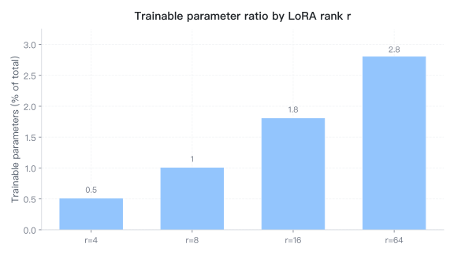

<sub>spec：<code>specs/b__bar.json</code> ｜ 参数键：categories · labels · values · xlabel · ylabel</sub>

<a id="grouped_bar"></a>
**`grouped_bar`** —— 多方案在不同类目上的分组对比

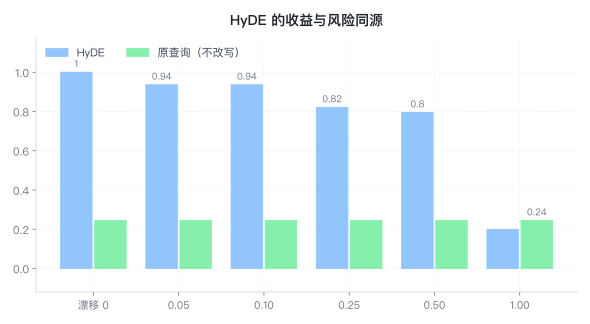

<sub>spec：<code>specs/b__grouped_bar.json</code> ｜ 参数键：categories · groups</sub>

<a id="stacked_bar"></a>
**`stacked_bar`** —— 构成占比随时间/类目变化（堆叠）

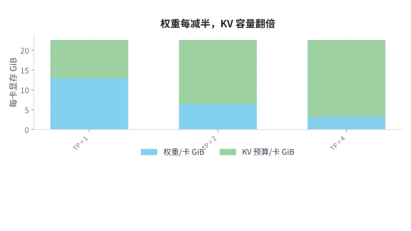

<sub>spec：<code>specs/b__stacked_bar.json</code> ｜ 参数键：categories · series · ylabel</sub>

<a id="multi_bar"></a>
**`multi_bar`** —— 多个子图并排的多组柱（跨组对比）

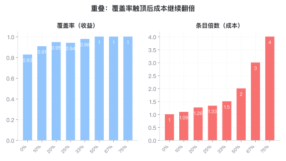

<sub>spec：<code>specs/b__multi_bar.json</code> ｜ 参数键：panels</sub>

<a id="pie"></a>
**`pie`** —— 整体构成占比（类别少时）

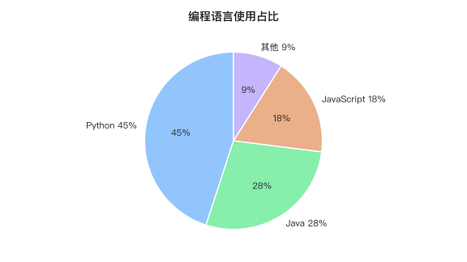

<sub>spec：<code>specs/b__pie.json</code> ｜ 参数键：labels · values</sub>

<a id="waterfall"></a>
**`waterfall`** —— 增量分解 / 特征贡献（瀑布图）

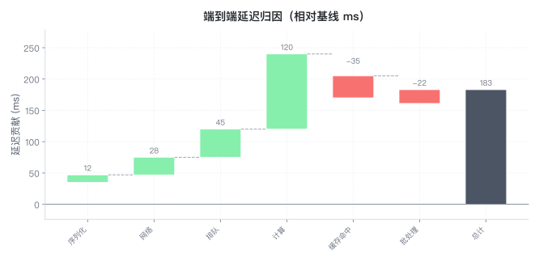

<sub>spec：<code>specs/b__waterfall.json</code> ｜ 参数键：items · show_total · start · total_label · value_fmt · ylabel</sub>

<a id="radar"></a>
**`radar`** —— 多指标多方案雷达对比

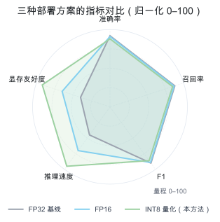

<sub>spec：<code>specs/b__radar.json</code> ｜ 参数键：axes · fill · series · ymax</sub>

<a id="venn2"></a>
**`venn2`** —— 两个集合的交并关系

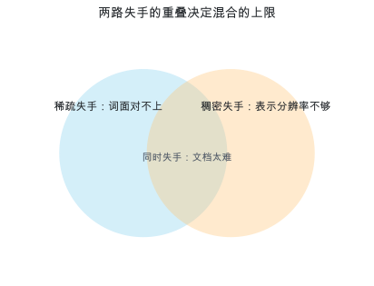

<sub>spec：<code>specs/b__venn2.json</code> ｜ 参数键：intersection · labels</sub>

<a id="matrix"></a>
**`matrix`** —— 文本表格（参数/结果对照表）

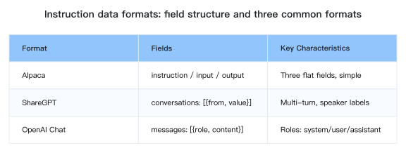

<sub>spec：<code>specs/b__matrix.json</code> ｜ 参数键：data</sub>

### B · 趋势与曲线（随自变量变化、多 run 均值±波动、指标曲线）

<a id="multi_curve"></a>
**`multi_curve`** —— 多条曲线/函数对比（含自定义表达式）

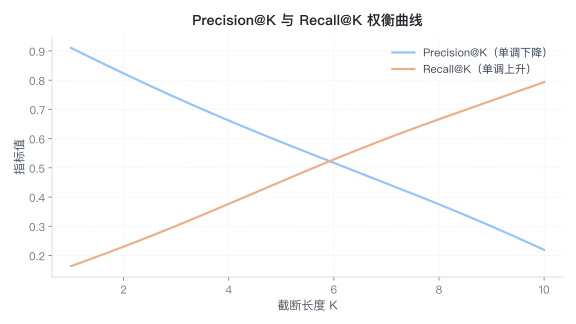

<sub>spec：<code>specs/b__multi_curve.json</code> ｜ 参数键：curves · xlabel · ylabel</sub>

<a id="function_curve"></a>
**`function_curve`** —— 单函数曲线（表达式驱动）

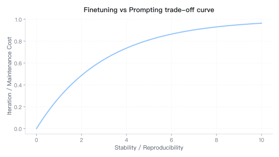

<sub>spec：<code>specs/b__function_curve.json</code> ｜ 参数键：func · x_max · x_min · xlabel · ylabel</sub>

<a id="area_line"></a>
**`area_line`** —— 带填充的趋势线（强调累积/幅度）

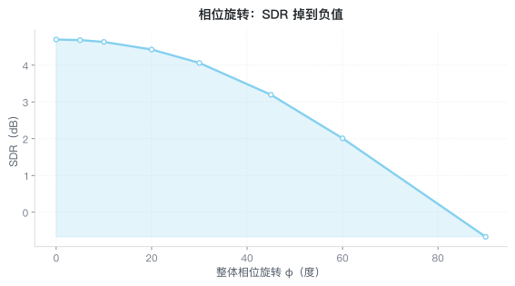

<sub>spec：<code>specs/b__area_line.json</code> ｜ 参数键：x · xlabel · y · ylabel</sub>

<a id="line_band"></a>
**`line_band`** —— 多 run / 多 seed 的均值 ± 标准差（波动带）

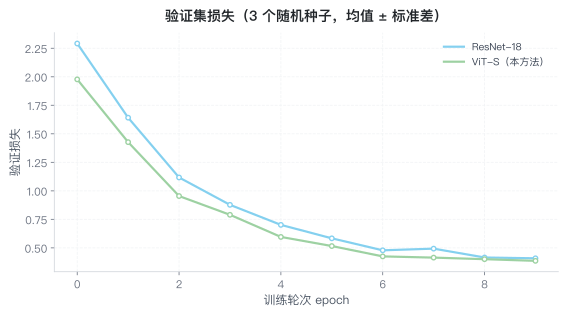

<sub>spec：<code>specs/b__line_band.json</code> ｜ 参数键：legend · logx · logy · no_markers · series · xlabel · ylabel</sub>

<a id="errorbar"></a>
**`errorbar`** —— 均值 ± 误差棒（柱或折线带误差）

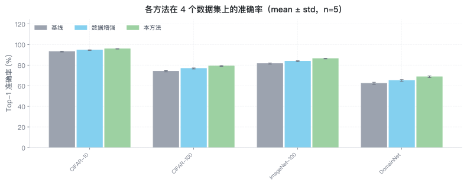

<sub>spec：<code>specs/b__errorbar.json</code> ｜ 参数键：categories · groups · kind · labels · legend · xlabel · y_min · ylabel</sub>

<a id="learning_curve"></a>
**`learning_curve`** —— 训练/验证损失（学习曲线）

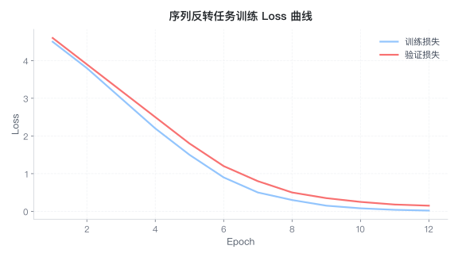

<sub>spec：<code>specs/b__learning_curve.json</code> ｜ 参数键：train · valid · x · xlabel · ylabel</sub>

<a id="twin_axis"></a>
**`twin_axis`** —— 两个量纲不同的指标共图（双轴）

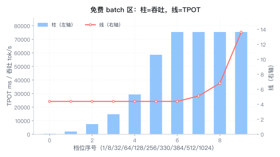

<sub>spec：<code>specs/b__twin_axis.json</code> ｜ 参数键：bar_label · bar_x · bar_y · label_left · label_right · line_label · line_x · line_y · mark_crossing · xlabel · ylabel · ylabel_left · ylabel_right</sub>

<a id="loglog"></a>
**`loglog`** —— 跨数量级的关系（双对数）

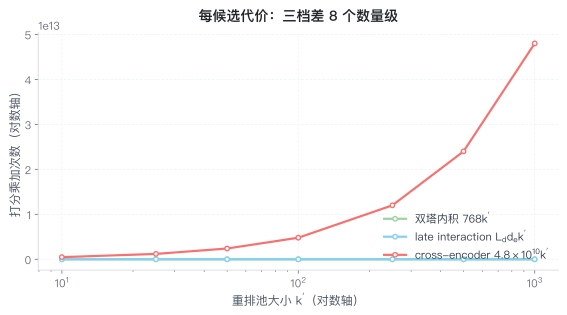

<sub>spec：<code>specs/b__loglog.json</code> ｜ 参数键：curves · xlabel · ylabel</sub>

<a id="elbow"></a>
**`elbow`** —— 肘部法则 / 拐点识别

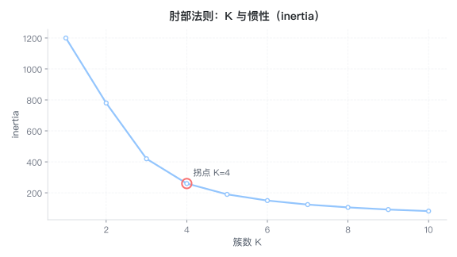

<sub>spec：<code>specs/b__elbow.json</code> ｜ 参数键：elbow_k · k · values · xlabel · ylabel</sub>

<a id="regularization_path"></a>
**`regularization_path`** —— 正则路径 / 系数收缩

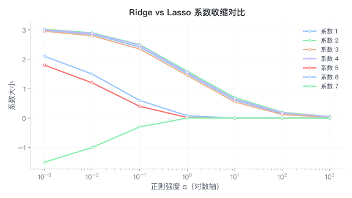

<sub>spec：<code>specs/b__regularization_path.json</code> ｜ 参数键：alphas · coefs · xlabel · ylabel</sub>

<a id="spectrum"></a>
**`spectrum`** —— 信号 / 频谱 / 谱图（可标峰值）

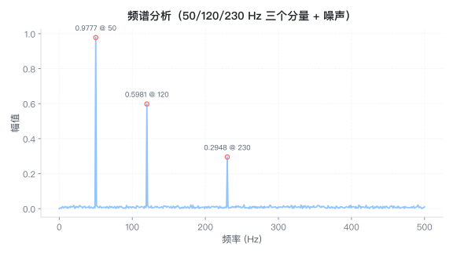

<sub>spec：<code>specs/b__spectrum.json</code> ｜ 参数键：amplitude · color · fill · freq · logx · logy · sample_rate · signal · top_peaks · x · xlabel · y · ylabel</sub>

<a id="multi_subplot"></a>
**`multi_subplot`** —— 多个子图并排（函数/序列逐格对比）

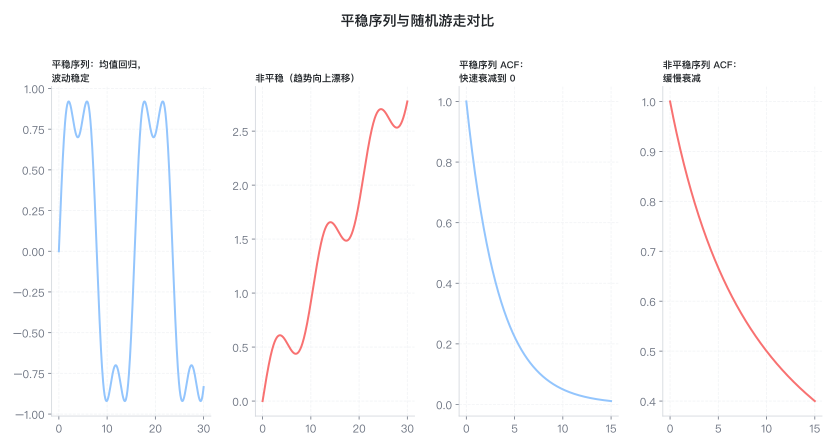

<sub>spec：<code>specs/b__multi_subplot.json</code> ｜ 参数键：panels</sub>

<a id="panels"></a>
**`panels`** —— 论文多面板组图（(a)(b)(c) 标签、共享轴）

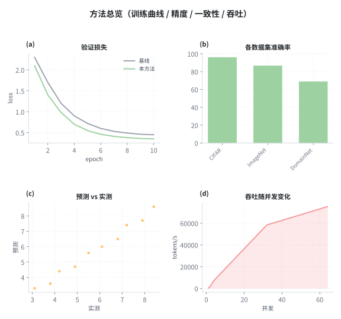

<sub>spec：<code>specs/b__panels.json</code> ｜ 参数键：each_in · ncols · panels · sharex · sharey · tags</sub>

### B · 分布与统计（分布形态、分位数、经验分布、离散概率）

<a id="normal_dist"></a>
**`normal_dist`** —— 正态分布密度（可填充 ±σ）

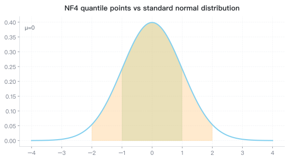

<sub>spec：<code>specs/b__normal_dist.json</code> ｜ 参数键：fill_sigma · mean · std · xlabel · ylabel</sub>

<a id="cdf"></a>
**`cdf`** —— 累积分布（理论）

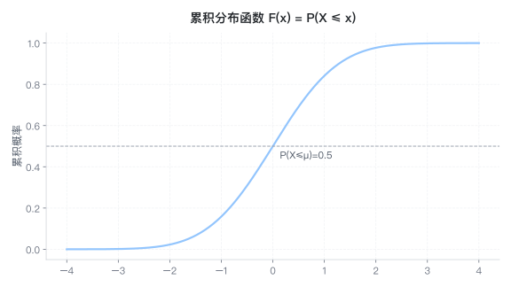

<sub>spec：<code>specs/b__cdf.json</code> ｜ 参数键：mean · std · xlabel · ylabel</sub>

<a id="ecdf"></a>
**`ecdf`** —— 经验累积分布（实测数据对比）

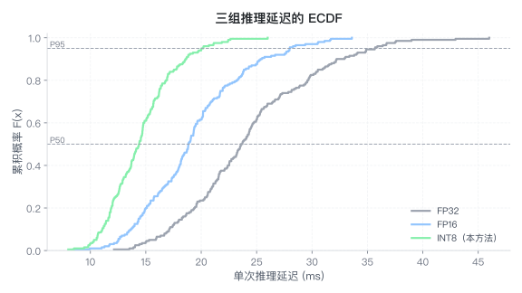

<sub>spec：<code>specs/b__ecdf.json</code> ｜ 参数键：groups · legend · mark_quantiles · series · show_points · xlabel · ylabel</sub>

<a id="pmf_pdf"></a>
**`pmf_pdf`** —— 离散 PMF vs 连续 PDF

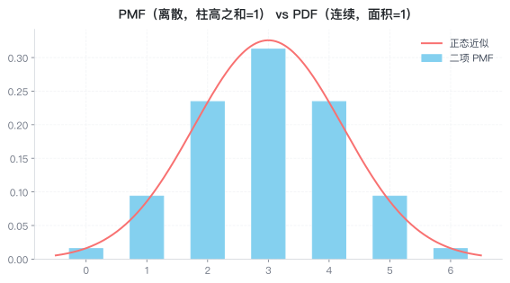

<sub>spec：<code>specs/b__pmf_pdf.json</code> ｜ 参数键：n · p · xlabel · ylabel</sub>

<a id="hist_fit"></a>
**`hist_fit`** —— 直方图 + 理论密度拟合

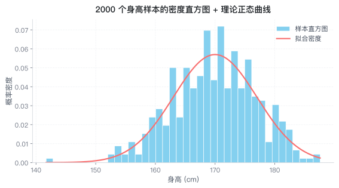

<sub>spec：<code>specs/b__hist_fit.json</code> ｜ 参数键：bins · data · func · xlabel · ylabel</sub>

<a id="kde"></a>
**`kde`** —— 核密度估计（可多峰混合）

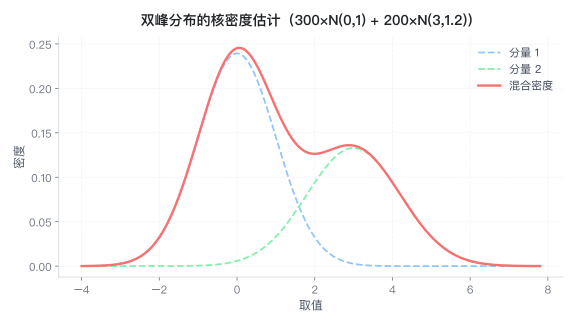

<sub>spec：<code>specs/b__kde.json</code> ｜ 参数键：curves · xlabel · ylabel</sub>

<a id="boxplot"></a>
**`boxplot`** —— 分组分布对比（箱线图）

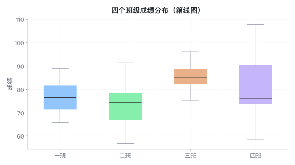

<sub>spec：<code>specs/b__boxplot.json</code> ｜ 参数键：groups · ylabel</sub>

<a id="box_jitter"></a>
**`box_jitter`** —— 箱线 + 原始散点抖动（样本量小必用）

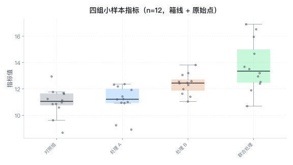

<sub>spec：<code>specs/b__box_jitter.json</code> ｜ 参数键：groups · jitter · show_box · size · xlabel · ylabel</sub>

<a id="violin"></a>
**`violin`** —— 分布形态对比（小提琴图）

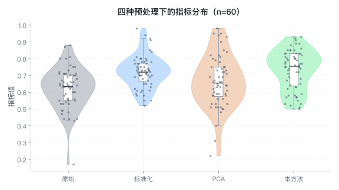

<sub>spec：<code>specs/b__violin.json</code> ｜ 参数键：groups · show_box · show_points · xlabel · ylabel</sub>

### B · 相关与拟合（两变量关系、拟合、残差、相关性矩阵）

<a id="scatter_fit"></a>
**`scatter_fit`** —— 散点 + 线性拟合

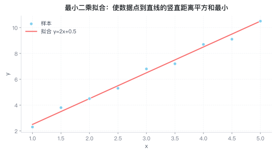

<sub>spec：<code>specs/b__scatter_fit.json</code> ｜ 参数键：grid · intercept · slope · x · xlabel · y · ylabel</sub>

<a id="scatter_classes"></a>
**`scatter_classes`** —— 多类别散点（可带中心点、对数轴）

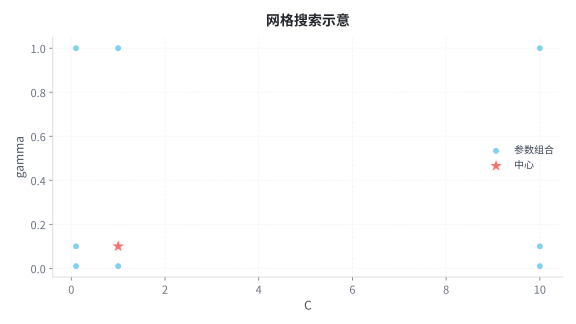

<sub>spec：<code>specs/b__scatter_classes.json</code> ｜ 参数键：centers · classes · xlabel · ylabel</sub>

<a id="scatter_boundary"></a>
**`scatter_boundary`** —— 分类边界（线性可分 / 不可分）

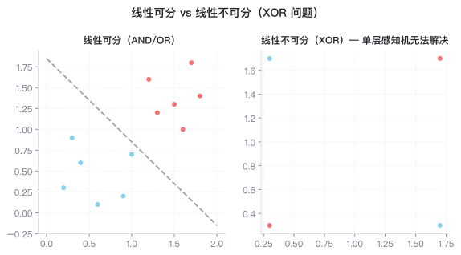

<sub>spec：<code>specs/b__scatter_boundary.json</code> ｜ 参数键：panels</sub>

<a id="scatter_panels"></a>
**`scatter_panels`** —— 多面板散点（迭代过程可视化）

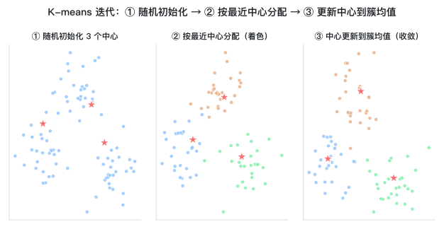

<sub>spec：<code>specs/b__scatter_panels.json</code> ｜ 参数键：ncols · panels</sub>

<a id="scatter_rich"></a>
**`scatter_rich`** —— 颜色/大小编码的散点（第三四维）

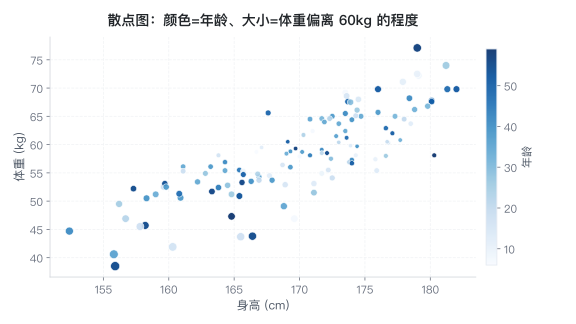

<sub>spec：<code>specs/b__scatter_rich.json</code> ｜ 参数键：c · colorbar_label · s · x · xlabel · y · ylabel</sub>

<a id="scatter_matrix"></a>
**`scatter_matrix`** —— 相关性/协方差矩阵式散点对比

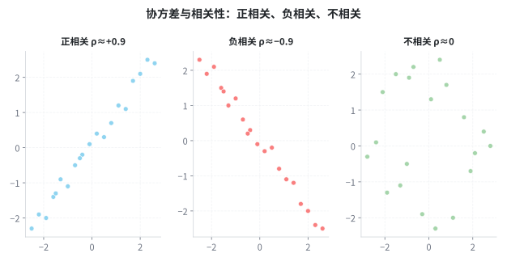

<sub>spec：<code>specs/b__scatter_matrix.json</code> ｜ 参数键：panels</sub>

<a id="fit_comparison"></a>
**`fit_comparison`** —— 欠拟合/合适/过拟合等拟合对比

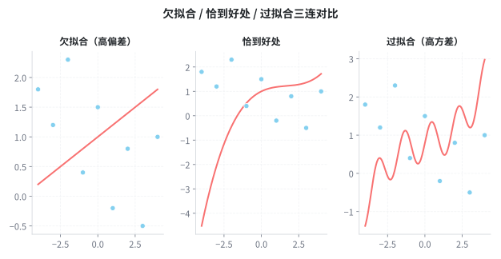

<sub>spec：<code>specs/b__fit_comparison.json</code> ｜ 参数键：panels</sub>

<a id="fit_band"></a>
**`fit_band`** —— 拟合 + 置信/预测带

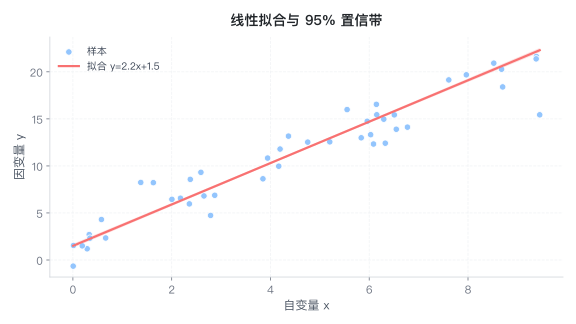

<sub>spec：<code>specs/b__fit_band.json</code> ｜ 参数键：band · color · intercept · label · legend · log · se · slope · t · x · xlabel · y · ylabel</sub>

<a id="parity"></a>
**`parity`** —— 预测 vs 实测 parity（含 R²/MAE/RMSE）

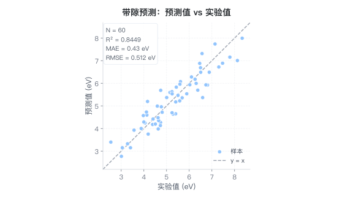

<sub>spec：<code>specs/b__parity.json</code> ｜ 参数键：actual · groups · label · log · metrics_loc · predicted · unit · xlabel · ylabel</sub>

<a id="residual"></a>
**`residual`** —— 残差诊断图（残差 vs 拟合值 + ±2σ）

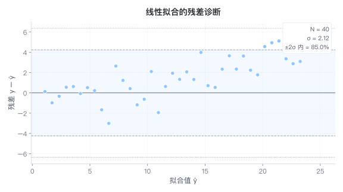

<sub>spec：<code>specs/b__residual.json</code> ｜ 参数键：band · fitted · intercept · metrics_loc · residual · sigma · slope · x · xlabel · y · ylabel</sub>

<a id="scatter3d"></a>
**`scatter3d`** —— 三维散点（可选：按类别着色）

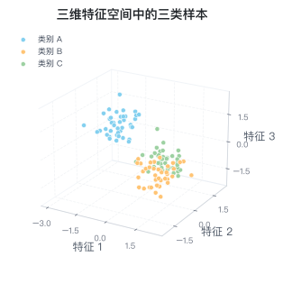

<sub>spec：<code>specs/b__scatter3d.json</code> ｜ 参数键：c · cmap · color · colorbar · colorbar_label · groups · size · x · xlabel · y · ylabel · z · zlabel</sub>

### B · 场与矩阵（热力图、混淆矩阵、张量、网络结构、等高线、3D 曲面）

<a id="heatmap"></a>
**`heatmap`** —— 二维热力图（计数/强度，带数值标注）

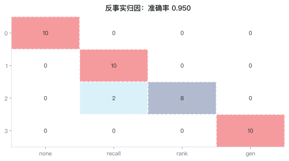

<sub>spec：<code>specs/b__heatmap.json</code> ｜ 参数键：annot · annot_fmt · cmap · colorbar · colorbar_label · data · labels · vmax · vmin · x_labels · xlabel · y_labels · ylabel</sub>

<a id="heatmap_panels"></a>
**`heatmap_panels`** —— 多面板热力图（含色条）

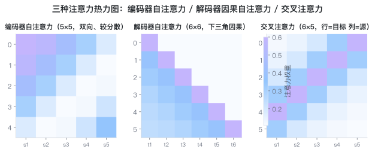

<sub>spec：<code>specs/b__heatmap_panels.json</code> ｜ 参数键：annot · colorbar · colorbar_label · ncols · panels</sub>

<a id="confusion"></a>
**`confusion`** —— 混淆矩阵（计数/行归一化）


<sub>spec：<code>specs/b__confusion.json</code> ｜ 参数键：annot_fmt · cmap · colorbar · colorbar_label · data · labels · matrix · metrics_in_figure · metrics_loc · normalize · xlabel · ylabel</sub>

<a id="clustered_heatmap"></a>
**`clustered_heatmap`** —— 表达矩阵热图（行列 z-score + 层次聚类重排，不画树）


<sub>spec：<code>specs/b__clustered_heatmap.json</code> ｜ 参数键：cluster · cmap · col_labels · colorbar · colorbar_label · data · row_labels · xlabel · ylabel · zscore</sub>

<a id="nn_twin"></a>
**`nn_twin`** —— 神经网络结构示意（单层 vs 多层）


<sub>spec：<code>specs/b__nn_twin.json</code> ｜ 参数键：left · right</sub>

<a id="tensor_blocks"></a>
**`tensor_blocks`** —— 0~3 维张量示意


<sub>spec：<code>specs/b__tensor_blocks.json</code> ｜ 参数键：—</sub>

<a id="tensor_cube_panels"></a>
**`tensor_cube_panels`** —— 三维张量 + 通道混合/独立做法对比


<sub>spec：<code>specs/b__tensor_cube_panels.json</code> ｜ 参数键：—</sub>

<a id="matrix_mul_panels"></a>
**`matrix_mul_panels`** —— 矩阵乘 vs 逐元素乘示意


<sub>spec：<code>specs/b__matrix_mul_panels.json</code> ｜ 参数键：—</sub>

<a id="contour_quiver"></a>
**`contour_quiver`** —— 等高线 + 梯度场


<sub>spec：<code>specs/b__contour_quiver.json</code> ｜ 参数键：grid · xlabel · ylabel</sub>

<a id="contourf"></a>
**`contourf`** —— 填充等高线 / 损失曲面（二维替代 3D）


<sub>spec：<code>specs/b__contourf.json</code> ｜ 参数键：cmap · colorbar · colorbar_label · data · func · levels · lines · mark_min · n · x_max · x_min · xlabel · y_max · y_min · ylabel</sub>

<a id="surface3d"></a>
**`surface3d`** —— 三维曲面 z=f(x,y)（可选；默认规范建议先用 contourf 做二维表达）


<sub>spec：<code>specs/b__surface3d.json</code> ｜ 参数键：alpha · cmap · colorbar · colorbar_label · wireframe · xlabel · ylabel · zlabel</sub>

### B · 评估与性能（模型质量与工程性能（ROC/校准/火焰图））

<a id="roc"></a>
**`roc`** —— ROC 曲线与 AUC


<sub>spec：<code>specs/b__roc.json</code> ｜ 参数键：auc · fpr · tpr · xlabel · ylabel</sub>

<a id="calibration"></a>
**`calibration`** —— 校准/可靠性曲线（含 ECE）


<sub>spec：<code>specs/b__calibration.json</code> ｜ 参数键：acc · accs · bins · conf · confs · count · counts · metrics_loc · show_hist · xlabel · ylabel</sub>

<a id="flamegraph"></a>
**`flamegraph`** —— 火焰图（perf/耗时归因，层级占比）


<sub>spec：<code>specs/b__flamegraph.json</code> ｜ 参数键：folded · hide_root · min_label_ratio · show_total · stacks</sub>

<a id="roofline"></a>
**`roofline`** —— Roofline 性能模型（算力/带宽上界）


<sub>spec：<code>specs/b__roofline.json</code> ｜ 参数键：bandwidth · peak_flops · points · xlabel · ylabel</sub>

### B · 优化与几何（梯度下降、切线/极限、向量与微分示意）

<a id="gradient_descent"></a>
**`gradient_descent`** —— 梯度下降轨迹示意


<sub>spec：<code>specs/b__gradient_descent.json</code> ｜ 参数键：xlabel · ylabel</sub>

<a id="multi_panel_gd"></a>
**`multi_panel_gd`** —— 不同学习率的下降轨迹对比


<sub>spec：<code>specs/b__multi_panel_gd.json</code> ｜ 参数键：panels</sub>

<a id="optimizer_paths"></a>
**`optimizer_paths`** —— 优化器路径对比（SGD/Adam…）


<sub>spec：<code>specs/b__optimizer_paths.json</code> ｜ 参数键：paths</sub>

<a id="tangent_secant"></a>
**`tangent_secant`** —— 割线逼近切线（导数含义）


<sub>spec：<code>specs/b__tangent_secant.json</code> ｜ 参数键：func · x0 · xlabel · ylabel</sub>

<a id="limit"></a>
**`limit`** —— 极限逼近示意


<sub>spec：<code>specs/b__limit.json</code> ｜ 参数键：func · x0 · xlabel · ylabel</sub>

<a id="differential"></a>
**`differential`** —— 微分 dy 与增量 Δy


<sub>spec：<code>specs/b__differential.json</code> ｜ 参数键：dx · func · x0 · xlabel · ylabel</sub>

<a id="vector2d"></a>
**`vector2d`** —— 二维向量 / 夹角 / 相似度


<sub>spec：<code>specs/b__vector2d.json</code> ｜ 参数键：lim · vectors · xlabel · ylabel</sub>

### B · 生医与统计推断（生存曲线、森林图、火山图、组学热图）

<a id="km"></a>
**`km`** —— Kaplan-Meier 生存曲线（含删失与风险表）


<sub>spec：<code>specs/b__km.json</code> ｜ 参数键：at_risk · groups · legend · risk_times · xlabel · ylabel</sub>

<a id="forest"></a>
**`forest`** —— 森林图 / 效应量与置信区间


<sub>spec：<code>specs/b__forest.json</code> ｜ 参数键：annotate · color_each · items · log · null · summary · summary_label · xlabel</sub>

<a id="volcano"></a>
**`volcano`** —— 火山图（差异表达：log2FC vs -log10 p）


<sub>spec：<code>specs/b__volcano.json</code> ｜ 参数键：fc · fc_threshold · label_top · legend · log2fc · names · p · p_threshold · pvalue · xlabel · ylabel</sub>

<!-- GALLERY:END -->

## 其它文档

- [SKILL.md](SKILL.md) —— 何时用 / 工作流 / 风格规范 / 版式红线 / 常见坑
- [TYPES.md](TYPES.md) —— 图型目录与选型（**由 catalog.py 生成**）
- [docs/SPEC-REFERENCE.md](docs/SPEC-REFERENCE.md) —— 顶层字段、两类 spec 骨架、嵌套参数约定
- 维护脚本：`scripts/build_examples.py`（重生成样例图）、`scripts/build_docs.py`（重生成 TYPES.md 与本文件画廊）
