# 图型目录与选型

> 本文件由 `scripts/build_docs.py` 从 `scripts/catalog.py` 生成，**不要手改**（改目录请改 catalog.py 后重跑）。
>
> 选型命令：`python3 scripts/draw.py --recommend "用一句话描述你要画的图"`：
> `--list` 按 14 个场景分类列图型：`--catalog --json` 给机器读；`--example <图型>` 打真实骨架。

| 类 | 数量 | 渲染器 | spec 里给什么 | 产物格式 |
|---|---|---|---|---|
| **A 类 · 结构/关系图** | 25 个 Mermaid 图族（6 个入口名等价） | Mermaid（内置运行时） | `mmd` 源码 | svg / png / webp |
| **B 类 · 数据/统计/科研图** | 70 种 | Matplotlib | `params` | svg / png / webp / pdf / eps / ps / jpeg / tiff |

## 场景分类总览

| 分类 id | 类 | 数量 | 什么时候用 |
|---|---|---|---|
| `flow` | A/B | 2 | 业务流程、算法流程、判定分支与回退 |
| `interaction` | A | 1 | 接口调用顺序、消息交互、上下游协作 |
| `state` | A | 1 | 订单/任务/连接的状态迁移 |
| `model` | A | 3 | ER 关系图、类图、业务关系图 |
| `arch` | A | 5 | 系统架构、分层、部署、C4 上下文 |
| `plan` | A | 15 | 排期、看板、旅程、需求、里程碑、分支流 |
| `compare` | B | 9 | 类目之间比大小、构成占比、增量分解 |
| `trend` | B | 13 | 随自变量变化、多 run 均值±波动、指标曲线 |
| `dist` | B | 9 | 分布形态、分位数、经验分布、离散概率 |
| `relate` | B | 11 | 两变量关系、拟合、残差、相关性矩阵 |
| `field` | B | 12 | 热力图、混淆矩阵、张量、网络结构、等高线、3D 曲面 |
| `eval` | B | 4 | 模型质量与工程性能（ROC/校准/火焰图） |
| `math` | B | 7 | 梯度下降、切线/极限、向量与微分示意 |
| `bio` | B | 3 | 生存曲线、森林图、火山图、组学热图 |

## A 类 · Mermaid 图族

A 类的 6 个入口名（`flow` `graph` `tree` `nn_diagram` `ladder` `timeline`）**彼此等价**：
`type` 填任意一个都行，真正决定画什么的是 `mmd` 里的第一行图型关键字。

### 流程与决策（flow）

| Mermaid 图族 | spec 的 type | 场景 | 关键词 |
|---|---|---|---|
| `flowchart` | `flow` | 业务流程 / 算法流程 / 判定与回退（最通用） | 流程 · 流程图 · 判定 · 分支 · 算法 · 步骤 · swimlane |

### 交互与时序（interaction）

| Mermaid 图族 | spec 的 type | 场景 | 关键词 |
|---|---|---|---|
| `sequenceDiagram` | `flow` | 接口调用链 / 消息时序（含 alt 分支、Note、激活块） | 时序图 · 调用链 · 交互 · 接口 · 消息 · sequence |

### 状态与生命周期（state）

| Mermaid 图族 | spec 的 type | 场景 | 关键词 |
|---|---|---|---|
| `stateDiagram-v2` | `flow` | 状态机 / 状态迁移（支持复合状态与 note） | 状态机 · 状态 · 迁移 · 生命周期 · 工单 · 订单状态 |

### 数据与领域模型（model）

| Mermaid 图族 | spec 的 type | 场景 | 关键词 |
|---|---|---|---|
| `flowchart` | `graph` | 关系网络 / 拓扑（无方向的连接关系） | 关系图 · 网络图 · 拓扑图 · 依赖图 · 关系网络 |
| `erDiagram` | `flow` | ER 图 / 数据模型 / 业务实体关系（含主外键与基数） | ER · ER图 · 数据模型 · 表关系 · 实体 · 业务关系 · 基数 |
| `classDiagram` | `flow` | 类图 / 领域模型（属性、方法、多重度、依赖） | 类图 · 领域模型 · 对象 · 类 · 继承 · 多重度 |

### 架构与上下文（arch）

| Mermaid 图族 | spec 的 type | 场景 | 关键词 |
|---|---|---|---|
| `architecture-beta` | `flow` | 图标化系统架构图（组件/部署，带云图标） | 架构图 · 图标化 · 组件图 · 部署图 · 云架构 |
| `C4Context` | `flow` | C4 上下文/容器图（人-系统-外部系统关系） | C4 · 上下文图 · 系统上下文 · 外部系统 |
| `flowchart` | `flow` | C4 风格架构图（人/本系统/外部系统 + 关系，用 flowchart 复刻，比 C4Context 可控） | C4 架构图 · C4 上下文图 · C4 · 上下文图 · 系统上下文 · 外部系统 · 架构上下文 |
| `flowchart` | `flow` | 分层架构图（subgraph 当泳道/分层，最稳的架构画法） | 分层架构 · 分层图 · 泳道 · 子系统 · 模块图 |

### 计划与协作（plan）

| Mermaid 图族 | spec 的 type | 场景 | 关键词 |
|---|---|---|---|
| `gantt` | `flow` | 排期 / 甘特图（依赖、里程碑、进度状态） | 甘特 · 排期 · 进度 · 里程碑 · gantt |
| `kanban` | `flow` | 看板（待办/进行中/已完成） | 看板 · 任务板 · kanban · 待办 |
| `journey` | `flow` | 用户旅程 / 体验地图（分阶段 + 评分） | 旅程 · 体验 · 用户旅程 · journey |
| `requirementDiagram` | `flow` | 需求与验证追踪（需求-元素-验证方法） | 需求 · 需求追踪 · 验证 · requirement |
| `timeline` | `timeline` | 时间线 / 演进史 / 里程碑脉络 | 时间线 · 演进 · 历史 · 里程碑 · timeline |
| `mindmap` | `flow` | 思维导图 / 能力拆解 | 思维导图 · 脑图 · 拆解 · mindmap |
| `gitGraph` | `flow` | Git 分支与合并流（发布/热修流程） | git · 分支 · 合并 · 发布流 · gitflow |
| `block-beta` | `flow` | 块图（矩阵式布局，适合分层/分组摆放） | 块图 · 布局 · block |
| `packet-beta` | `flow` | 协议/报文结构（字段位宽） | 协议 · 报文 · 字段 · 位宽 · packet |
| `pie` | `flow` | 饼图（Mermaid 版，占比） | 饼图 · 占比 · pie |
| `quadrantChart` | `flow` | 四象限优先级（成本×收益、影响×难度） | 象限 · 优先级 · 四象限 · quadrant |
| `xychart-beta` | `flow` | 简单柱+线指标图（Mermaid 版，轻量） | 指标 · 柱线 · xychart · 趋势图 |
| `sankey-beta` | `flow` | 流量/去向归因（桑基图） | 桑基 · 流量 · 归因 · sankey |
| `treemap-beta` | `flow` | 树图 / 面积占比（层级构成） | 树图 · treemap · 面积 |
| `radar-beta` | `flow` | 雷达图（Mermaid 版，多指标对比） | 雷达 · 多指标 · radar |

## B 类 · 数据图（70 种）

`参数键` 一列由 `drawers.py` 源码自动抽取（`p.get("…")`），不会和实现漂移；
嵌套结构（`panels[]` `series[]` `groups[]` `curves[]` 等）见 [docs/SPEC-REFERENCE.md](docs/SPEC-REFERENCE.md)。

### 流程与决策（flow）—— 业务流程、算法流程、判定分支与回退

| 图型 | 场景 | 关键词 | 参数键 | 样例 |
|---|---|---|---|---|
| `swimlane` | 泳道图 / 跨职能流程图（原生绘制，最可控） | 泳道图 · 跨职能 · swimlane · 泳道 · 责任分工 | `direction` · `edges` · `lanes` · `row_height` · `step_width` · `steps` | [spec](specs/b__swimlane.json) · [SVG](docs/examples/swimlane.svg) |

### 架构与上下文（arch）—— 系统架构、分层、部署、C4 上下文

| 图型 | 场景 | 关键词 | 参数键 | 样例 |
|---|---|---|---|---|
| `arch_diagram` | 大模型架构图（编码器/解码器堆叠 + Add & Norm + 残差 + 跨列连接，由 params.columns 描述） | 架构图 · Transformer · BERT · GPT · 编码器 · 解码器 · 注意力 · 模型结构 · 神经网络结构 | `bus_gap` · `columns` · `head` · `head_label` | [spec](specs/b__arch_diagram.json) · [SVG](docs/examples/arch_diagram.svg) |

### 对比与构成（compare）—— 类目之间比大小、构成占比、增量分解

| 图型 | 场景 | 关键词 | 参数键 | 样例 |
|---|---|---|---|---|
| `bar` | 单一维度的类目比大小 / 排名 | 柱状图 · 对比 · 排名 · bar | `categories` · `labels` · `values` · `xlabel` · `ylabel` | [spec](specs/b__bar.json) · [SVG](docs/examples/bar.svg) |
| `grouped_bar` | 多方案在不同类目上的分组对比 | 分组柱 · 多方案对比 · grouped | `categories` · `groups` | [spec](specs/b__grouped_bar.json) · [SVG](docs/examples/grouped_bar.svg) |
| `stacked_bar` | 构成占比随时间/类目变化（堆叠） | 堆叠 · 构成 · 占比 | `categories` · `series` · `ylabel` | [spec](specs/b__stacked_bar.json) · [SVG](docs/examples/stacked_bar.svg) |
| `multi_bar` | 多个子图并排的多组柱（跨组对比） | 多子图柱 · 并排 · panel bar | `panels` | [spec](specs/b__multi_bar.json) · [SVG](docs/examples/multi_bar.svg) |
| `pie` | 整体构成占比（类别少时） | 饼图 · 占比 · 构成 · pie | `labels` · `values` | [spec](specs/b__pie.json) · [SVG](docs/examples/pie.svg) |
| `waterfall` | 增量分解 / 特征贡献（瀑布图） | 瀑布 · 增量 · 贡献 · 归因 · waterfall | `items` · `show_total` · `start` · `total_label` · `value_fmt` · `ylabel` | [spec](specs/b__waterfall.json) · [SVG](docs/examples/waterfall.svg) |
| `radar` | 多指标多方案雷达对比 | 雷达 · 多指标 · 蜘蛛 · radar | `axes` · `fill` · `series` · `ymax` | [spec](specs/b__radar.json) · [SVG](docs/examples/radar.svg) |
| `venn2` | 两个集合的交并关系 | 韦恩 · 交集 · 重叠 · venn | `intersection` · `labels` | [spec](specs/b__venn2.json) · [SVG](docs/examples/venn2.svg) |
| `matrix` | 文本表格（参数/结果对照表） | 表格 · 对照表 · table · matrix | `data` | [spec](specs/b__matrix.json) · [SVG](docs/examples/matrix.svg) |

### 趋势与曲线（trend）—— 随自变量变化、多 run 均值±波动、指标曲线

| 图型 | 场景 | 关键词 | 参数键 | 样例 |
|---|---|---|---|---|
| `multi_curve` | 多条曲线/函数对比（含自定义表达式） | 多条曲线 · 对比曲线 · 函数 · curve | `curves` · `xlabel` · `ylabel` | [spec](specs/b__multi_curve.json) · [SVG](docs/examples/multi_curve.svg) |
| `function_curve` | 单函数曲线（表达式驱动） | 函数曲线 · 表达式 · function | `func` · `x_max` · `x_min` · `xlabel` · `ylabel` | [spec](specs/b__function_curve.json) · [SVG](docs/examples/function_curve.svg) |
| `area_line` | 带填充的趋势线（强调累积/幅度） | 面积图 · 填充 · 趋势 | `x` · `xlabel` · `y` · `ylabel` | [spec](specs/b__area_line.json) · [SVG](docs/examples/area_line.svg) |
| `line_band` | 多 run / 多 seed 的均值 ± 标准差（波动带） | 误差带 · 波动带 · 标准差 · 置信区间 · 多次实验 · 多次运行 · 均值 · seeds · band · ± | `legend` · `logx` · `logy` · `no_markers` · `series` · `xlabel` · `ylabel` | [spec](specs/b__line_band.json) · [SVG](docs/examples/line_band.svg) |
| `errorbar` | 均值 ± 误差棒（柱或折线带误差） | 误差棒 · errorbar · 标准差 · mean±std | `categories` · `groups` · `kind` · `labels` · `legend` · `xlabel` · `y_min` · `ylabel` | [spec](specs/b__errorbar.json) · [SVG](docs/examples/errorbar.svg) |
| `learning_curve` | 训练/验证损失（学习曲线） | 学习曲线 · 损失 · 训练 · loss | `train` · `valid` · `x` · `xlabel` · `ylabel` | [spec](specs/b__learning_curve.json) · [SVG](docs/examples/learning_curve.svg) |
| `twin_axis` | 两个量纲不同的指标共图（双轴） | 双轴 · 双 Y · 量纲 · twin | `bar_label` · `bar_x` · `bar_y` · `label_left` · `label_right` · `line_label` · `line_x` · `line_y` · `mark_crossing` · `xlabel` · `ylabel` · `ylabel_left` · `ylabel_right` | [spec](specs/b__twin_axis.json) · [SVG](docs/examples/twin_axis.svg) |
| `loglog` | 跨数量级的关系（双对数） | 对数 · loglog · 数量级 · 幂律 | `curves` · `xlabel` · `ylabel` | [spec](specs/b__loglog.json) · [SVG](docs/examples/loglog.svg) |
| `elbow` | 肘部法则 / 拐点识别 | 肘部 · 拐点 · K 值 · elbow | `elbow_k` · `k` · `values` · `xlabel` · `ylabel` | [spec](specs/b__elbow.json) · [SVG](docs/examples/elbow.svg) |
| `regularization_path` | 正则路径 / 系数收缩 | 正则 · 收缩 · 系数 · lasso | `alphas` · `coefs` · `xlabel` · `ylabel` | [spec](specs/b__regularization_path.json) · [SVG](docs/examples/regularization_path.svg) |
| `spectrum` | 信号 / 频谱 / 谱图（可标峰值） | 频谱 · 信号 · 谱图 · FFT · 峰 | `amplitude` · `color` · `fill` · `freq` · `logx` · `logy` · `sample_rate` · `signal` · `top_peaks` · `x` · `xlabel` · `y` · `ylabel` | [spec](specs/b__spectrum.json) · [SVG](docs/examples/spectrum.svg) |
| `multi_subplot` | 多个子图并排（函数/序列逐格对比） | 多子图 · 并排子图 · 子图对比 · subplot | `panels` | [spec](specs/b__multi_subplot.json) · [SVG](docs/examples/multi_subplot.svg) |
| `panels` | 论文多面板组图（(a)(b)(c) 标签、共享轴） | 多面板 · 组图 · 子图 · (a)(b) · paper | `each_in` · `ncols` · `panels` · `sharex` · `sharey` · `tags` | [spec](specs/b__panels.json) · [SVG](docs/examples/panels.svg) |

### 分布与统计（dist）—— 分布形态、分位数、经验分布、离散概率

| 图型 | 场景 | 关键词 | 参数键 | 样例 |
|---|---|---|---|---|
| `normal_dist` | 正态分布密度（可填充 ±σ） | 正态 · 高斯 · 密度 | `fill_sigma` · `mean` · `std` · `xlabel` · `ylabel` | [spec](specs/b__normal_dist.json) · [SVG](docs/examples/normal_dist.svg) |
| `cdf` | 累积分布（理论） | CDF · 累积分布 · 分位 | `mean` · `std` · `xlabel` · `ylabel` | [spec](specs/b__cdf.json) · [SVG](docs/examples/cdf.svg) |
| `ecdf` | 经验累积分布（实测数据对比） | ECDF · 经验分布 · 累积 | `groups` · `legend` · `mark_quantiles` · `series` · `show_points` · `xlabel` · `ylabel` | [spec](specs/b__ecdf.json) · [SVG](docs/examples/ecdf.svg) |
| `pmf_pdf` | 离散 PMF vs 连续 PDF | PMF · PDF · 二项 · 离散概率 | `n` · `p` · `xlabel` · `ylabel` | [spec](specs/b__pmf_pdf.json) · [SVG](docs/examples/pmf_pdf.svg) |
| `hist_fit` | 直方图 + 理论密度拟合 | 直方图 · 分布拟合 · hist | `bins` · `data` · `func` · `xlabel` · `ylabel` | [spec](specs/b__hist_fit.json) · [SVG](docs/examples/hist_fit.svg) |
| `kde` | 核密度估计（可多峰混合） | 核密度 · KDE · 密度估计 | `curves` · `xlabel` · `ylabel` | [spec](specs/b__kde.json) · [SVG](docs/examples/kde.svg) |
| `boxplot` | 分组分布对比（箱线图） | 箱线图 · 分位数 · 离群 · boxplot | `groups` · `ylabel` | [spec](specs/b__boxplot.json) · [SVG](docs/examples/boxplot.svg) |
| `box_jitter` | 箱线 + 原始散点抖动（样本量小必用） | 抖动 · 散点+箱线 · jitter · 小样本 | `groups` · `jitter` · `show_box` · `size` · `xlabel` · `ylabel` | [spec](specs/b__box_jitter.json) · [SVG](docs/examples/box_jitter.svg) |
| `violin` | 分布形态对比（小提琴图） | 小提琴 · 分布形态 · violin | `groups` · `show_box` · `show_points` · `xlabel` · `ylabel` | [spec](specs/b__violin.json) · [SVG](docs/examples/violin.svg) |

### 相关与拟合（relate）—— 两变量关系、拟合、残差、相关性矩阵

| 图型 | 场景 | 关键词 | 参数键 | 样例 |
|---|---|---|---|---|
| `scatter_fit` | 散点 + 线性拟合 | 散点 · 拟合 · 回归 · 最小二乘 · 相关性 · 相关关系 | `grid` · `intercept` · `slope` · `x` · `xlabel` · `y` · `ylabel` | [spec](specs/b__scatter_fit.json) · [SVG](docs/examples/scatter_fit.svg) |
| `scatter_classes` | 多类别散点（可带中心点、对数轴） | 分类散点 · 聚类 · 类别 | `centers` · `classes` · `xlabel` · `ylabel` | [spec](specs/b__scatter_classes.json) · [SVG](docs/examples/scatter_classes.svg) |
| `scatter_boundary` | 分类边界（线性可分 / 不可分） | 决策边界 · XOR · 可分 | `panels` | [spec](specs/b__scatter_boundary.json) · [SVG](docs/examples/scatter_boundary.svg) |
| `scatter_panels` | 多面板散点（迭代过程可视化） | 多面板散点 · 迭代 · 簇 | `ncols` · `panels` | [spec](specs/b__scatter_panels.json) · [SVG](docs/examples/scatter_panels.svg) |
| `scatter_rich` | 颜色/大小编码的散点（第三四维） | 气泡图 · 颜色编码 · 大小编码 | `c` · `colorbar_label` · `s` · `x` · `xlabel` · `y` · `ylabel` | [spec](specs/b__scatter_rich.json) · [SVG](docs/examples/scatter_rich.svg) |
| `scatter_matrix` | 相关性/协方差矩阵式散点对比 | 相关矩阵 · 相关性分析 · 协方差 · 散点矩阵 | `panels` | [spec](specs/b__scatter_matrix.json) · [SVG](docs/examples/scatter_matrix.svg) |
| `fit_comparison` | 欠拟合/合适/过拟合等拟合对比 | 欠拟合 · 过拟合 · 拟合对比 | `panels` | [spec](specs/b__fit_comparison.json) · [SVG](docs/examples/fit_comparison.svg) |
| `fit_band` | 拟合 + 置信/预测带 | 置信带 · 预测带 · 拟合区间 | `band` · `color` · `intercept` · `label` · `legend` · `log` · `se` · `slope` · `t` · `x` · `xlabel` · `y` · `ylabel` | [spec](specs/b__fit_band.json) · [SVG](docs/examples/fit_band.svg) |
| `parity` | 预测 vs 实测 parity（含 R²/MAE/RMSE） | parity · 预测对比 · 一致性 · 误差指标 | `actual` · `groups` · `label` · `log` · `metrics_loc` · `predicted` · `unit` · `xlabel` · `ylabel` | [spec](specs/b__parity.json) · [SVG](docs/examples/parity.svg) |
| `residual` | 残差诊断图（残差 vs 拟合值 + ±2σ） | 残差 · 诊断 · 异方差 | `band` · `fitted` · `intercept` · `metrics_loc` · `residual` · `sigma` · `slope` · `x` · `xlabel` · `y` · `ylabel` | [spec](specs/b__residual.json) · [SVG](docs/examples/residual.svg) |
| `scatter3d` | 三维散点（可选：按类别着色） | 3D 散点 · 三维散点 · scatter3d | `c` · `cmap` · `color` · `colorbar` · `colorbar_label` · `groups` · `size` · `x` · `xlabel` · `y` · `ylabel` · `z` · `zlabel` | [spec](specs/b__scatter3d.json) · [SVG](docs/examples/scatter3d.svg) |

### 场与矩阵（field）—— 热力图、混淆矩阵、张量、网络结构、等高线、3D 曲面

| 图型 | 场景 | 关键词 | 参数键 | 样例 |
|---|---|---|---|---|
| `heatmap` | 二维热力图（计数/强度，带数值标注） | 热力图 · heatmap · 强度 | `annot` · `annot_fmt` · `cmap` · `colorbar` · `colorbar_label` · `data` · `labels` · `vmax` · `vmin` · `x_labels` · `xlabel` · `y_labels` · `ylabel` | [spec](specs/b__heatmap.json) · [SVG](docs/examples/heatmap.svg) |
| `heatmap_panels` | 多面板热力图（含色条） | 多面板热力图 · 注意力 · attention | `annot` · `colorbar` · `colorbar_label` · `ncols` · `panels` | [spec](specs/b__heatmap_panels.json) · [SVG](docs/examples/heatmap_panels.svg) |
| `confusion` | 混淆矩阵（计数/行归一化） | 混淆矩阵 · confusion · 分类结果 | `annot_fmt` · `cmap` · `colorbar` · `colorbar_label` · `data` · `labels` · `matrix` · `metrics_in_figure` · `metrics_loc` · `normalize` · `xlabel` · `ylabel` | [spec](specs/b__confusion.json) · [SVG](docs/examples/confusion.svg) |
| `clustered_heatmap` | 表达矩阵热图（行列 z-score + 层次聚类重排，不画树） | 聚类热图 · 表达矩阵 · 组学 · z-score · 热图重排 | `cluster` · `cmap` · `col_labels` · `colorbar` · `colorbar_label` · `data` · `dendrogram` · `row_labels` · `xlabel` · `ylabel` · `zscore` | [spec](specs/b__clustered_heatmap.json) · [SVG](docs/examples/clustered_heatmap.svg) |
| `nn_twin` | 神经网络结构示意（单层 vs 多层） | 网络结构 · MLP · 全连接 · 神经元 · 网络示意图 | `left` · `right` | [spec](specs/b__nn_twin.json) · [SVG](docs/examples/nn_twin.svg) |
| `nn_single` | 单个神经网络结构（神经元级全连接图，不做左右对比） | 神经网络 · 神经元 · 全连接网络 · MLP · 网络结构图 | `layer_labels` · `layers` | [spec](specs/b__nn_single.json) · [SVG](docs/examples/nn_single.svg) |
| `tensor_blocks` | 0~3 维张量示意 | 张量 · 维度 · tensor | — | [spec](specs/b__tensor_blocks.json) · [SVG](docs/examples/tensor_blocks.svg) |
| `tensor_cube_panels` | 三维张量 + 通道混合/独立做法对比 | 张量示意 · 通道混合 | — | [spec](specs/b__tensor_cube_panels.json) · [SVG](docs/examples/tensor_cube_panels.svg) |
| `matrix_mul_panels` | 矩阵乘 vs 逐元素乘示意 | 矩阵乘 · 逐元素 · broadcast | — | [spec](specs/b__matrix_mul_panels.json) · [SVG](docs/examples/matrix_mul_panels.svg) |
| `contour_quiver` | 等高线 + 梯度场 | 等高线 · 梯度场 · quiver | `grid` · `xlabel` · `ylabel` | [spec](specs/b__contour_quiver.json) · [SVG](docs/examples/contour_quiver.svg) |
| `contourf` | 填充等高线 / 损失曲面（二维替代 3D） | 填充等高线 · 损失曲面 · 色阶 · contourf | `cmap` · `colorbar` · `colorbar_label` · `data` · `func` · `levels` · `lines` · `mark_min` · `n` · `x_max` · `x_min` · `xlabel` · `y_max` · `y_min` · `ylabel` | [spec](specs/b__contourf.json) · [SVG](docs/examples/contourf.svg) |
| `surface3d` | 三维曲面 z=f(x,y)（可选；默认规范建议先用 contourf 做二维表达） | 3D 曲面 · 曲面 · surface · 三维 | `alpha` · `cmap` · `colorbar` · `colorbar_label` · `wireframe` · `xlabel` · `ylabel` · `zlabel` | [spec](specs/b__surface3d.json) · [SVG](docs/examples/surface3d.svg) |

### 评估与性能（eval）—— 模型质量与工程性能（ROC/校准/火焰图）

| 图型 | 场景 | 关键词 | 参数键 | 样例 |
|---|---|---|---|---|
| `roc` | ROC 曲线与 AUC | ROC · AUC · 分类阈值 | `auc` · `fpr` · `tpr` · `xlabel` · `ylabel` | [spec](specs/b__roc.json) · [SVG](docs/examples/roc.svg) |
| `calibration` | 校准/可靠性曲线（含 ECE） | 校准 · 可靠性 · ECE · confidence | `acc` · `accs` · `bins` · `conf` · `confs` · `count` · `counts` · `metrics_loc` · `show_hist` · `xlabel` · `ylabel` | [spec](specs/b__calibration.json) · [SVG](docs/examples/calibration.svg) |
| `flamegraph` | 火焰图（perf/耗时归因，层级占比） | 火焰图 · 性能剖析 · perf · 火焰 | `axis` · `folded` · `hide_root` · `labels` · `min_label_ratio` · `row_height` · `show_root` · `show_total` · `sortby` · `stacks` · `total_label` · `unit` · `value_labels` · `xlabel` | [spec](specs/b__flamegraph.json) · [SVG](docs/examples/flamegraph.svg) |
| `roofline` | Roofline 性能模型（算力/带宽上界） | roofline · 性能模型 · 上界 | `bandwidth` · `peak_flops` · `points` · `xlabel` · `ylabel` | [spec](specs/b__roofline.json) · [SVG](docs/examples/roofline.svg) |

### 优化与几何（math）—— 梯度下降、切线/极限、向量与微分示意

| 图型 | 场景 | 关键词 | 参数键 | 样例 |
|---|---|---|---|---|
| `gradient_descent` | 梯度下降轨迹示意 | 梯度下降 · 轨迹 | `xlabel` · `ylabel` | [spec](specs/b__gradient_descent.json) · [SVG](docs/examples/gradient_descent.svg) |
| `multi_panel_gd` | 不同学习率的下降轨迹对比 | 学习率 · 下降轨迹 · 轨迹对比 | `panels` | [spec](specs/b__multi_panel_gd.json) · [SVG](docs/examples/multi_panel_gd.svg) |
| `optimizer_paths` | 优化器路径对比（SGD/Adam…） | 优化器 · 路径 · adam · sgd | `paths` | [spec](specs/b__optimizer_paths.json) · [SVG](docs/examples/optimizer_paths.svg) |
| `tangent_secant` | 割线逼近切线（导数含义） | 切线 · 割线 · 导数 | `func` · `x0` · `xlabel` · `ylabel` | [spec](specs/b__tangent_secant.json) · [SVG](docs/examples/tangent_secant.svg) |
| `limit` | 极限逼近示意 | 极限 · 逼近 | `func` · `x0` · `xlabel` · `ylabel` | [spec](specs/b__limit.json) · [SVG](docs/examples/limit.svg) |
| `differential` | 微分 dy 与增量 Δy | 微分 · 增量 · 线性近似 | `dx` · `func` · `x0` · `xlabel` · `ylabel` | [spec](specs/b__differential.json) · [SVG](docs/examples/differential.svg) |
| `vector2d` | 二维向量 / 夹角 / 相似度 | 向量 · 夹角 · 余弦 | `lim` · `vectors` · `xlabel` · `ylabel` | [spec](specs/b__vector2d.json) · [SVG](docs/examples/vector2d.svg) |

### 生医与统计推断（bio）—— 生存曲线、森林图、火山图、组学热图

| 图型 | 场景 | 关键词 | 参数键 | 样例 |
|---|---|---|---|---|
| `km` | Kaplan-Meier 生存曲线（含删失与风险表） | 生存曲线 · KM · Kaplan · 删失 · 生存分析 | `at_risk` · `groups` · `legend` · `risk_times` · `xlabel` · `ylabel` | [spec](specs/b__km.json) · [SVG](docs/examples/km.svg) |
| `forest` | 森林图 / 效应量与置信区间 | 森林图 · 效应量 · OR · HR · 置信区间 · meta | `annotate` · `color_each` · `items` · `log` · `null` · `summary` · `summary_label` · `xlabel` | [spec](specs/b__forest.json) · [SVG](docs/examples/forest.svg) |
| `volcano` | 火山图（差异表达：log2FC vs -log10 p） | 火山图 · 差异表达 · volcano · p 值 | `fc` · `fc_threshold` · `label_top` · `legend` · `log2fc` · `names` · `p` · `p_threshold` · `pvalue` · `xlabel` · `ylabel` | [spec](specs/b__volcano.json) · [SVG](docs/examples/volcano.svg) |

## A 类起手骨架（可直接抄进 `mmd`）

**flowchart** —— 业务流程 / 算法流程 / 判定与回退（最通用）（spec 的 `type` 填 `flow`）

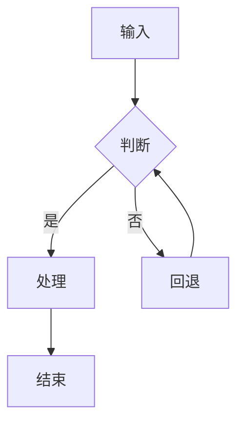

**flowchart** —— 关系网络 / 拓扑（无方向的连接关系）（spec 的 `type` 填 `graph`）

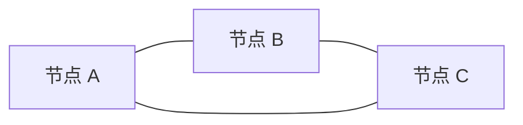

**sequenceDiagram** —— 接口调用链 / 消息时序（含 alt 分支、Note、激活块）（spec 的 `type` 填 `flow`）

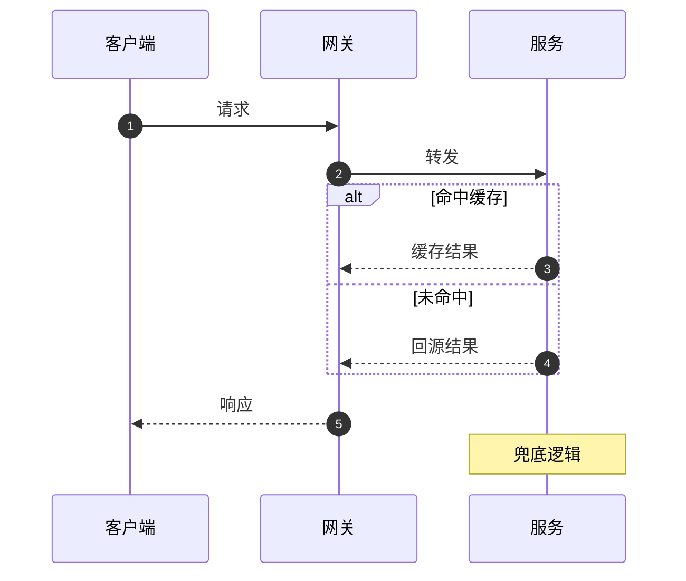

**stateDiagram-v2** —— 状态机 / 状态迁移（支持复合状态与 note）（spec 的 `type` 填 `flow`）

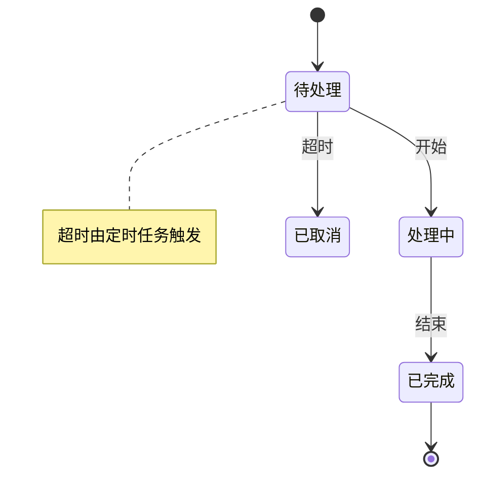

**erDiagram** —— ER 图 / 数据模型 / 业务实体关系（含主外键与基数）（spec 的 `type` 填 `flow`）

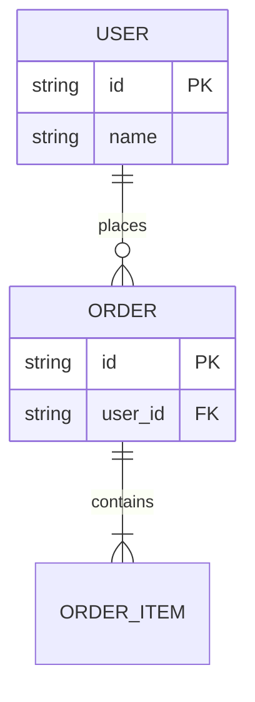

**classDiagram** —— 类图 / 领域模型（属性、方法、多重度、依赖）（spec 的 `type` 填 `flow`）

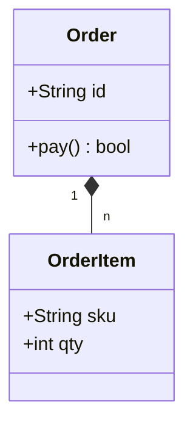

**architecture-beta** —— 图标化系统架构图（组件/部署，带云图标）（spec 的 `type` 填 `flow`）


**C4Context** —— C4 上下文/容器图（人-系统-外部系统关系）（spec 的 `type` 填 `flow`）

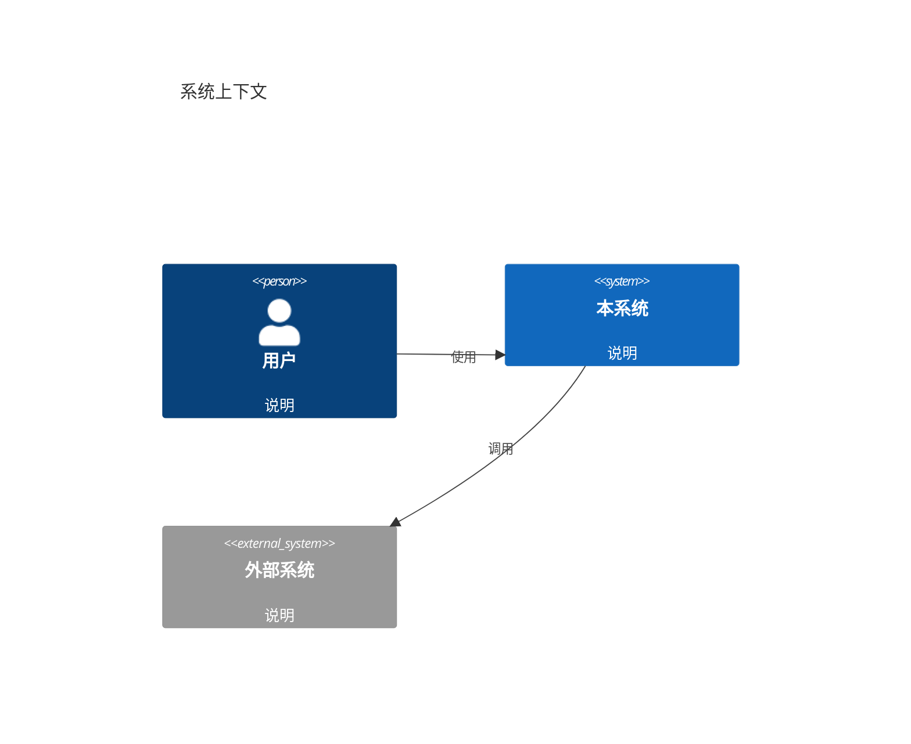

**flowchart** —— C4 风格架构图（人/本系统/外部系统 + 关系，用 flowchart 复刻，比 C4Context 可控）（spec 的 `type` 填 `flow`）

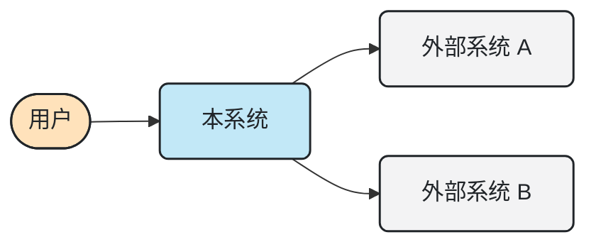

**flowchart** —— 分层架构图（subgraph 当泳道/分层，最稳的架构画法）（spec 的 `type` 填 `flow`）

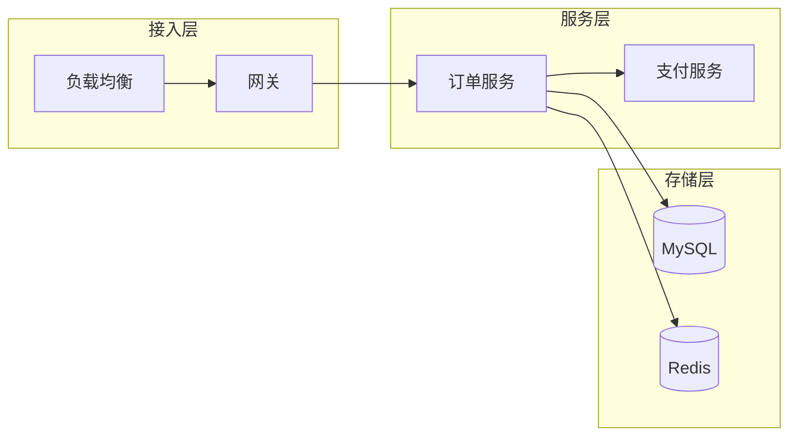

**gantt** —— 排期 / 甘特图（依赖、里程碑、进度状态）（spec 的 `type` 填 `flow`）

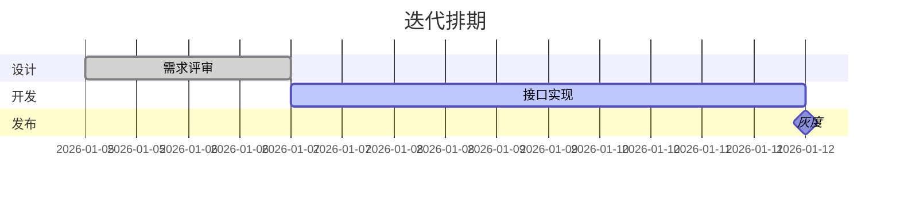

**kanban** —— 看板（待办/进行中/已完成）（spec 的 `type` 填 `flow`）


**journey** —— 用户旅程 / 体验地图（分阶段 + 评分）（spec 的 `type` 填 `flow`）

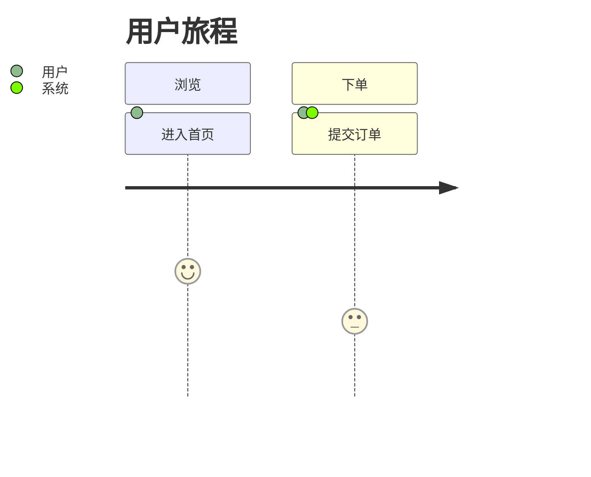

**requirementDiagram** —— 需求与验证追踪（需求-元素-验证方法）（spec 的 `type` 填 `flow`）

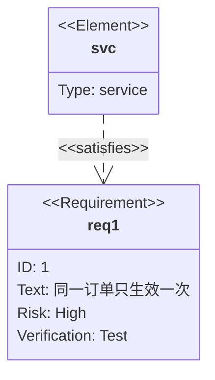

**timeline** —— 时间线 / 演进史 / 里程碑脉络（spec 的 `type` 填 `timeline`）

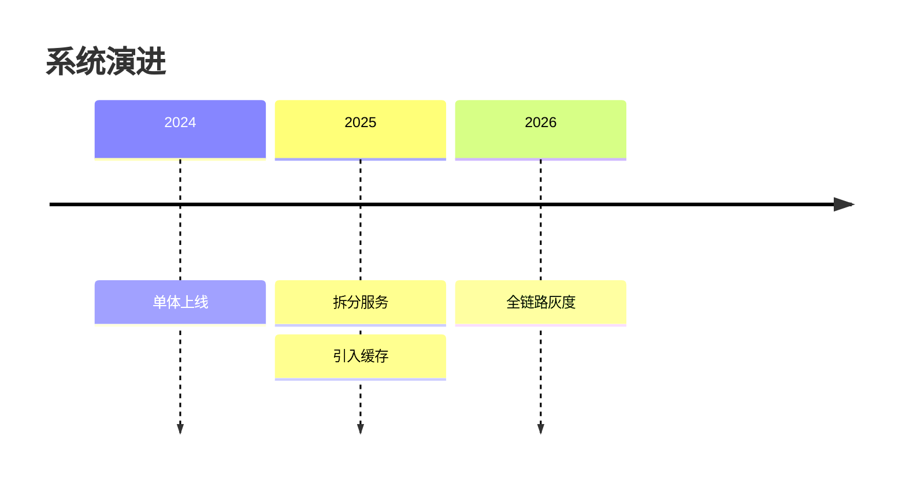

**mindmap** —— 思维导图 / 能力拆解（spec 的 `type` 填 `flow`）

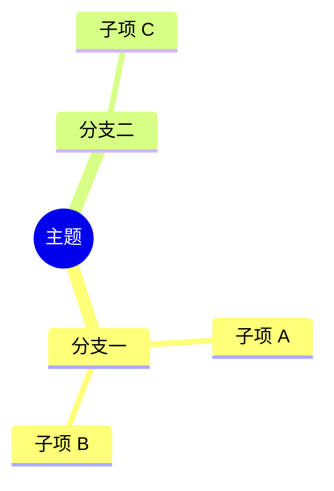

**gitGraph** —— Git 分支与合并流（发布/热修流程）（spec 的 `type` 填 `flow`）

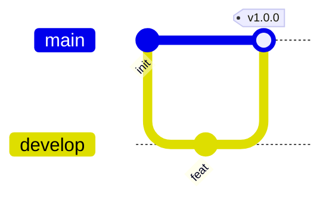

**block-beta** —— 块图（矩阵式布局，适合分层/分组摆放）（spec 的 `type` 填 `flow`）


**packet-beta** —— 协议/报文结构（字段位宽）（spec 的 `type` 填 `flow`）

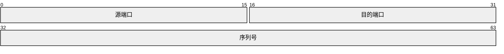

**pie** —— 饼图（Mermaid 版，占比）（spec 的 `type` 填 `flow`）

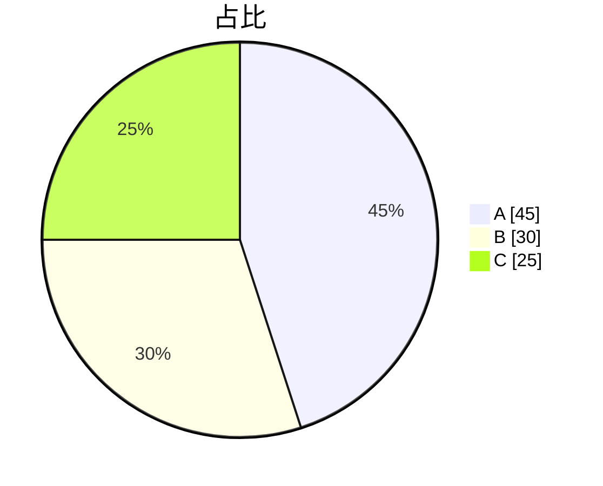

**quadrantChart** —— 四象限优先级（成本×收益、影响×难度）（spec 的 `type` 填 `flow`）

```mermaid
quadrantChart
  title 优先级
  x-axis 成本低 --> 成本高
  y-axis 影响小 --> 影响大
  quadrant-1 尽快做
  quadrant-2 排期做
  quadrant-3 有空再说
  quadrant-4 别做
  事项 A: [0.25, 0.85]
  事项 B: [0.8, 0.4]
```

**xychart-beta** —— 简单柱+线指标图（Mermaid 版，轻量）（spec 的 `type` 填 `flow`）

```mermaid
xychart-beta
  title "P99 延迟 (ms)"
  x-axis [v1.0, v1.1, v1.2]
  y-axis "P99" 0 --> 400
  bar [320, 210, 150]
  line [320, 210, 150]
```

**sankey-beta** —— 流量/去向归因（桑基图）（spec 的 `type` 填 `flow`）

```mermaid
sankey-beta

Request,CacheHit,620
Request,Origin,380
Origin,SlowQuery,90
Origin,FastQuery,290
```

**treemap-beta** —— 树图 / 面积占比（层级构成）（spec 的 `type` 填 `flow`）

```mermaid
treemap-beta
"根"
    "A": 30
    "B": 20
    "C": 50
```

**radar-beta** —— 雷达图（Mermaid 版，多指标对比）（spec 的 `type` 填 `flow`）

```mermaid
radar-beta
  title 健康度
  axis a["错误率"], b["延迟"], c["吞吐"]
  curve s1["改造前"]{80, 70, 60}
  curve s2["改造后"]{40, 35, 90}
```

## 替代写法 / 已知边界（都能出图，但换写法更稳）

| 想要 | 现状 | 建议 |
|---|---|---|
| 泳道图（跨职能流程） | ✅ 已支持：B 类 `swimlane`（`lanes` + `steps` + `edges`，原生绘制，布局可控） | 直接 `--example swimlane` |
| 聚类树（dendrogram） | ✅ 已支持：`clustered_heatmap` 给 `dendrogram: true`（平均连接层次聚类 + 行/列树） | 需要更专业的树请用 scipy/seaborn |
| 桑基图 `sankey-beta` | ⚠️ 内置 Mermaid 的 sankey **只接受 ASCII 节点名**：源/目标含中文（即使加引号）都会解析失败 | 节点名用英文（数值与结构不受影响）；或用 B 类 `waterfall` / `stacked_bar` 表达构成与流向 |
| ZenUML | ❌ 内置的单文件 mermaid bundle 不含该图型 | 渲染器会**直接给出** `sequenceDiagram` 骨架（alt/loop/par/Note 都支持） |
| C4 上下文 / 容器图 | ⚠️ 能出图，但 Mermaid 的 C4 自动布局容易把描述文字和关系标签叠在一起（会告警 + 给建议） | 用 `flowchart` 复刻 C4 风格（见上方 arch 分类的骨架），或缩短 description |
| gitGraph | ⚠️ commit 标签多时容易互相压 | 减少分支/提交，或拆图 |
| radar-beta / treemap-beta / journey | ✅ 越界已由**自动扩画布**兜底（越界量记在 `meta.layout.canvasFitted`） | 维度/层级过多时仍建议减少 |
| 3D 曲面 | ⚠️ 可用（`surface3d` / `scatter3d`）但不是首选：本 skill 的视觉规范是二维软色板 | 优先 `contourf`（填充等高线） |

